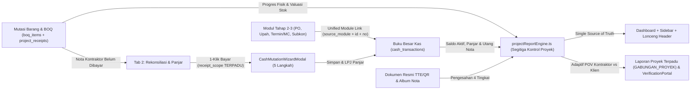

# PANDUAN RESMI: ENGINE DINAMIS MUTASI DANA, MULTI-POV, & REKONSILIASI TERPADU PROYEK CAIR

> **STATUS DOKUMEN: DRAF FINAL ARSITEKTUR & RENCANA IMPLEMENTASI TERPADU (REVISI 3 — AUDIT AGENTS.MD SELESAI)**  
> **Rujukan Baku:** [AGENTS.md](file:///c:/Users/A%20C%20E%20R/antigravity/Proyek%20Cair/AGENTS.md) · [MAtrix Impersona.pdf](file:///c:/Users/A%20C%20E%20R/antigravity/Proyek%20Cair/docs/MAtrix%20Impersona.pdf) · [TATA_KELOLA_KOREKSI_GANTI_DAN_VERIFIKASI_NOTA.md](file:///c:/Users/A%20C%20E%20R/antigravity/Proyek%20Cair/docs/TATA_KELOLA_KOREKSI_GANTI_DAN_VERIFIKASI_NOTA.md) · [PANDUAN_ENGINE_DINAMIS_MULTI_POV_DAN_MATRIKS_KEPUTUSAN.md](file:///c:/Users/A%20C%20E%20R/antigravity/Proyek%20Cair/docs/PANDUAN_ENGINE_DINAMIS_MULTI_POV_DAN_MATRIKS_KEPUTUSAN.md)

Dokumen ini menetapkan **rancangan arsitektur, tata kelola basis data, logika *engine* dinamis, dan antarmuka lengkap** untuk meningkatkan modul **Mutasi Dana** ([CashflowView.tsx](file:///c:/Users/A%20C%20E%20R/antigravity/Proyek%20Cair/src/components/CashflowView.tsx)) agar **setara kualitasnya di seluruh aspek** (*all-aspect parity*) dengan modul **Mutasi Barang** ([StockMutationView.tsx](file:///c:/Users/A%20C%20E%20R/antigravity/Proyek%20Cair/src/components/StockMutationView.tsx)), sekaligus menutup seluruh *bug* kalkulasi dan menyambungkan jembatan rekonsiliasi dua arah antara arus kas dengan nota belanja fisik proyek.

---

## 1. LANDASAN PRINSIP & MATRIKS PARITAS KUALITAS (*ALL-ASPECT PARITY*)

### A. Kepatuhan Terhadap Empat Kaidah Baku ([AGENTS.md](file:///c:/Users/A%20C%20E%20R/antigravity/Proyek%20Cair/AGENTS.md))
1. **Bahasa Indonesia 100%, Ergonomis, Terang/Gelap, Notifikasi & Badge:** Seluruh antarmuka memakai **100% bahasa Indonesia** baku proyek/keuangan yang ringkas, hemat alfabet, bebas ambigu, mendukung tema **Terang (*Light*) & Gelap (*Dark*)** berkontras tinggi (WCAG AA), serta menampilkan **Notifikasi** dan **Badge User** yang akurat. Istilah campur Inggris seperti `(IN)`, `(OUT)`, `Ref:`, atau `Free-Issue` dihapus seluruhnya dari UI.
2. **Kerumitan Ditangani Engine di Latar Belakang:** Pembukuan saldo berjalan, pengecualian baris `BATAL`/`DIGANTI`, rekonsiliasi nota barang-kas, pelacakan cicilan panjar/kasbon, dan penguncian persetujuan berseri diproses otomatis oleh *pure engine* (`src/lib/cashflowEngine.ts`). Pengguna lapangan cukup melihat status jujur dan menekan 1 tombol paling tepat.
3. **Integrasi Penuh & Efek Domino:** Seluruh kalkulasi kas bersumber dari satu kebenaran tunggal (*single source of truth*) dan terhubung langsung ke Dasbor, Bilah Samping (*Sidebar*), Lonceng Notifikasi *Header*, Mutasi Barang (`project_receipts`), Studio Laporan PDF, serta Ekspor PDF QR.
4. **Saran Cerdas Dinamis (*Smart-Suggestion*):** Dilarang menampilkan tombol mati (*disabled*) di tabel atau *header* maupun *hardcode* label aksi. Saat kas masih kosong (`Rp 0`), sistem menonjolkan **`+ Kas Masuk`**; saat ada nota gudang belum terbayar, muncul pintas **`[ ↑ Bayar ]`** otomatis terisi; saat panjar terbuka, tombol berubah menjadi **`[ ✓ Lunasi ]`**; saat menunggu giliran pengawas, muncul **`[ ✓ Periksa ]`** / **`[ ✓ Setuju ]`** / **`[ ✓ Sahkan ]`**.

### B. Matriks Paritas Kualitas 13 Aspek: *As-Is* vs Standar Mutasi Barang vs *To-Be* Mutasi Dana

| No | Aspek Penilaian | Kondisi Mutasi Dana Saat Ini (*As-Is*) | Standar Mutasi Barang (*Benchmark*) | Target Mutasi Dana Baru (*To-Be*) |
| :-: | :--- | :--- | :--- | :--- |
| **1** | **Skema Database (`Supabase`)** | Tabel `cash_transactions` hanya **23 kolom**, belum punya kolom bukti, toko, metode bayar, beban biaya, pos BOQ, maupun kasbon/panjar. | Tabel `inventory_transactions` **43 kolom** + tabel `project_receipts` & `supplier_stores`. | Migrasi idempoten menambah kolom bukti, metode bayar, beban biaya, relasi `receipt_id`, `boq_item_id`, serta siklus `panjar/kasbon` yang terindeks rapi. |
| **2** | **Arsitektur Engine & Unit Test** | **0 engine terpisah** dan **0 unit test**; logika tersebar & duplikat di komponen. | `stockMutationEngine.ts` + `boqExecutionEngine.ts` + 13 rangkaian uji otomatis (`npm test`). | Berkas murni `src/lib/cashflowEngine.ts` + `src/lib/cashflowEngine.test.ts` dengan **$\ge 15$ skenario uji otomatis**. |
| **3** | **Sudut Pandang & Tab Operasional** | Hanya **2 tab mentah** (Jurnal Harian & Dokumen Kas) tanpa kontrol anggaran maupun rekonsiliasi nota. | **4 Tab Terpadu**: Stok Gudang, Realisasi BOQ, Riwayat Mutasi, Dokumen Resmi. | **4 Tab Terpadu**: `Ringkasan & Anggaran`, `Rekonsiliasi & Panjar`, `Jurnal Transaksi Kas`, `Dokumen Resmi (TTE/QR)`. |
| **4** | **Alur Input Transaksi Baru** | Modal datar 1 halaman berisi 6 *field*; tanpa pilihan PIC, catatan tidak tampil, tanpa simpan beruntun. | Wizard tanya-jawab dinamis (`StockMutationWizardModal`) 5 langkah + tombol `Simpan & Catat Lagi`. | Wizard cerdas (`CashMutationWizardModal`) **3 langkah ringkas** (atau **2 klik ekspres** dari Tab Rekonsiliasi) + *auto-derivasi* beban biaya + saran pintar saldo tidak cukup + unggah bukti + `Simpan & Catat Lagi`. |
| **5** | **Bukti Kuitansi, Zoom HD & Album** | **0% dukungan** foto bukti transfer/kuitansi, tanpa kompresi, tanpa album, tanpa *zoom viewer*. | Kompresi otomatis kamera HP, `ReceiptViewerModal` (Zoom 300%, Rotate), & `ProjectReceiptAlbumModal`. | Berbagi `project_receipts` via `receipt_scope`, unggah multi-lembar terkompresi, Album Kuitansi Proyek, & *Viewer* HD terpadu. |
| **6** | **Integrasi Barang $\leftrightarrow$ Dana** | Terputus total; pembelian material di gudang tidak memunculkan tagihan di kas dan harus diketik ulang. | Mencatat harga satuan beli, toko, `nomor_nota`, `total_nota_fisik`, & `receipt_id`. | Tab **Rekonsiliasi** otomatis menampilkan antrean nota belanja gudang belum dibayar + tombol 1-klik **`Bayar`** *pre-filled* 100%. |
| **7** | **Panjar / Kasbon & Talangan Klien** | Tidak ada pelacakan uang muka mandor/pelaksana maupun piutang talangan atas nama Klien. | Memisahkan hak & porsi `KONTRAKTOR` vs `KLIEN` vs `CAMPURAN` secara akurat. | Siklus utuh **Panjar Terbuka $\rightarrow$ LPJ bebas *double-counting*** (`<`, `=`, `>` panjar) via `lpj_kategori_riil` + pengembalian/tambahan otomatis, serta **Piutang Talangan Klien**. |
| **8** | **Smart-Header & 1 Smart-Button Fixed-Slot** | Tombol header `+ Kas Masuk (IN)` / `- Kas Keluar (OUT)` redup/mati untuk 5 pengawas; kolom aksi memakai dual tombol `Batal`/`Ganti` statis. | Smart-Header adaptif peran & antrean + 1 Smart-Button *Fixed-Slot* (`min-w-[82px]` / `min-w-[114px]`, anti zig-zag). | Identik standar Mutasi Barang: Smart-Header bebas tombol mati, 1 Smart-Button *Fixed-Slot* per baris, `h-7` desktop / `min-h-[34px]` sentuh. |
| **9** | **Multi-POV & Privasi Finansial** | Banner di `CashflowView.tsx#L529-L536` mengklaim Viewer bisa melihat saldo kas, bertolak belakang dengan penguncian di `App.tsx` & `Sidebar.tsx`. | Pemisahan tegas `KONTRAKTOR` vs `KLIEN` (`canViewFinancials = false`), bebas kebocoran data internal. | Kas internal kontraktor & arsip dokumen (`documents.audience_pov`) 100% terproteksi untuk `KLIEN` (`Viewer`) di `App.tsx modalOnly`, `ReportsView`, & `VerificationPortal`; tagihan talangan lewat PDF preset khusus `Tagihan Penggantian Klien`. |
| **10** | **Alarm, Badge Sidebar & Lonceng Header** | Menu `Mutasi Dana` polos tanpa badge; Card 1 Dasbor statis tidak bisa diklik; lonceng header abai pada antrean kas. | `outOfStockCount` terkunci ketat pada kondisi kritis `S-4` (bebas alarm palsu), badge Sidebar aktif. | Badge Sidebar adaptif warna (*tone-aware*, merah hanya `K-4`); Card 1 Dasbor interaktif + banner kritis khusus `K-4`; badge angka lonceng Header menggabungkan RFIN + antrean persetujuan Barang & Kas. |
| **11** | **Ekspor PDF & Preset Profil** | PDF kas default *portrait* sempit, tanpa preset di modal ekspor, dan penanda tangan baris 2–3 *hardcode*. | Ekspor modal punya preset profil 1-klik, PDF kaya kolom & rincian penyedia. | Otomatis *Landscape* bila $> 6$ kolom, **4 Preset Profil Kas 1-Klik**, tanda tangan nama penyetuju aktual, ringkasan per kategori & metode bayar. |
| **12** | **Konsistensi Kalkulasi Lintas Modul** | **Bug aktif:** `DashboardView.tsx` & `ReportsView.tsx` masih menghitung nominal transaksi `BATAL`/`DIGANTI`. | Semua komponen membaca `boqExecutionEngine.ts` (konsistensi 100% di seluruh aplikasi). | `isCashRowExcluded()` dan `computeCashSummaryMetrics()` wajib menjadi sumber tunggal di seluruh tampilan & PDF. |
| **13** | **Integrasi Ekosistem & Laporan Proyek Terpadu** | Laporan terpecah menjadi 4 berkas terpisah di `ReportsView.tsx`; tanpa kontrak tautan modul masa depan. | [types/index.ts](file:///c:/Users/A%20C%20E%20R/antigravity/Proyek%20Cair/src/types/index.ts#L165) sudah menyiapkan `'GABUNGAN_PROYEK'`; [LandingPageView.tsx](file:///c:/Users/A%20C%20E%20R/antigravity/Proyek%20Cair/src/components/LandingPageView.tsx#L44-L141) memetakan 8 modul ekosistem. | Kolom *Unified Module Link* (`source_module`, `source_entity_id`, `source_entity_no`) + `projectReportEngine.ts` + Kartu ke-5 **`Laporan Proyek Terpadu (GABUNGAN_PROYEK)`** via `generateIntegratedProjectReportPDF()`. |

---

## 2. HASIL AUDIT KODE & DATABASE EXISTING (12 TEMUAN KRITIS)

Audit langsung terhadap basis kode dan skema tabel *live* Supabase (`project_id: qqshrapshwjiehuiyzeq`) membuktikan **12 kesenjangan nyata** berikut:

1. **Bug Kalkulasi `BATAL`/`DIGANTI` di Dasbor ([DashboardView.tsx](file:///c:/Users/A%20C%20E%20R/antigravity/Proyek%20Cair/src/components/DashboardView.tsx#L88-L94)):**
   `totalCashIn` dan `totalCashOut` menjumlahkan seluruh `cashMutations` tanpa mengecualikan baris `is_batal`, `is_ganti`, `status_dokumen === 'BATAL'`, atau `'DIGANTI'`. Akibatnya angka `Masuk - Keluar` tidak cocok dengan `currentCashBalance` yang dihitung di [AppContext.tsx](file:///c:/Users/A%20C%20E%20R/antigravity/Proyek%20Cair/src/context/AppContext.tsx#L709-L716).
2. **Bug Penjumlahan Masuk+Keluar & `BATAL` di Studio Laporan ([ReportsView.tsx](file:///c:/Users/A%20C%20E%20R/antigravity/Proyek%20Cair/src/components/ReportsView.tsx#L177-L193)):**
   Pada pratinjau laporan kas, `totalNilai` menjumlahkan nominal `MASUK` dan `KELUAR` ke satu total bruto serta ikut menghitung transaksi yang sudah dibatalkan/diganti.
3. **Ketidakcocokan Skema Database `cash_transactions` (23 Kolom) vs Kebutuhan Aplikasi:**
   Pemeriksaan skema `public.cash_transactions` menunjukkan tabel ini hanya memiliki 23 kolom (bandingkan `public.inventory_transactions` dengan 43 kolom). Pada [AppContext.tsx](file:///c:/Users/A%20C%20E%20R/antigravity/Proyek%20Cair/src/context/AppContext.tsx#L737-L746), *mapper* sudah mencoba membaca kolom `harga_satuan_beli`, `status_harga`, `nama_item_aktual`, `tanggal_nota`, `nama_toko`, `toko_kontak`, `total_nota_fisik`, `lampiran_nota_urls`, dan `receipt_id`, namun kolom-kolom tersebut **belum ada di tabel `cash_transactions`** dan fungsi `addCashMutation` (`#L997-L1010`) maupun `gantiCashMutation` (`#L1048-L1062`) belum menyimpannya saat menulis ke database.
4. **Cacat Form Input Kas & Modal `Ganti` ([CashflowView.tsx](file:///c:/Users/A%20C%20E%20R/antigravity/Proyek%20Cair/src/components/CashflowView.tsx#L1210-L1444)):**
   * **Tidak ada input PIC:** Form tidak memiliki kolom pengisian nama penerima/penyerah uang; nilai diam-diam diisi `user.name` (`#L250`).
   * **State `notes` Yatim:** State `notes` (`#L84`) dikirim ke `addCashMutation` (`#L282`), tetapi **tidak pernah ada input catatan di JSX form**.
   * **Label & Opsi Kategori Bias Keluar:** Saat mencatat `Kas Masuk`, label tetap bertuliskan `"Kategori Pengeluaran"` (`#L1275`) dan masih menawarkan kategori `Material`/`Upah & Konsumsi`/`Sewa Alat & Angkut`.
   * **Kerusakan Kronologi Audit pada `handleConfirmGanti` (`#L350`):** Mengganti baris kas selalu menimpa tanggal transaksi lama dengan `new Date().toISOString()` alih-alih mempertahankan tanggal transaksi asli (bisa diubah secara sadar bila memang tanggalnya salah).
   * **Absennya Input Bukti, Toko, Metode Bayar, Beban Biaya, & Panjar:** Form tidak mendukung unggah foto bukti/transfer, status bukti menyusul, maupun pencatatan beruntun (`Simpan & Catat Lagi`).
5. **Filter Kategori Mati & Kolom Saldo Berjalan Hilang ([CashflowView.tsx](file:///c:/Users/A%20C%20E%20R/antigravity/Proyek%20Cair/src/components/CashflowView.tsx#L65)):**
   `const [filterCategory] = useState<string>('ALL');` dideklarasikan tanpa tombol/dropdown filter di UI. Di tabel Jurnal Kas (`#L712-L878`), kolom **`Saldo Berjalan (saldo_setelah)`** tidak ditampilkan per baris, dan tidak ada filter periode cepat maupun tautan lompat ke baris pengganti (`referensi_ganti_id`).
6. **Kontradiksi Privasi `Viewer/Pengamat` ([CashflowView.tsx](file:///c:/Users/A%20C%20E%20R/antigravity/Proyek%20Cair/src/components/CashflowView.tsx#L529-L536) vs [App.tsx](file:///c:/Users/A%20C%20E%20R/antigravity/Proyek%20Cair/src/App.tsx#L123-L137)):**
   Di `CashflowView.tsx` masih terdapat banner yang berbunyi *"Anda memiliki akses transparansi penuh untuk mengamati saldo kas..."*, bertentangan langsung dengan `App.tsx`, [Sidebar.tsx](file:///c:/Users/A%20C%20E%20R/antigravity/Proyek%20Cair/src/components/Sidebar.tsx#L118-L120), dan prinsip `canViewFinancials = false` pada panduan Multi-POV.
7. **Tombol Mati (`disabled`) & Bahasa Campuran Inggris:**
   Tombol `+ Kas Masuk (IN)` dan `- Kas Keluar (OUT)` (`CashflowView.tsx#L567-L585`), label `IN`/`OUT` (`DashboardView.tsx#L916`), dan `Ref:` melanggar `AGENTS.md` Aturan 1 dan Aturan 4. Di Tab Dokumen (`#L1035-L1061`), tombol persetujuan tampil `disabled` untuk peran lain bukannya adaptif sesuai giliran.
8. **Alur Persetujuan Berjenjang Transaksi Kas Belum Aktif di UI:**
   Fungsi `advanceCashWorkflow` sudah tersedia di [AppContext.tsx](file:///c:/Users/A%20C%20E%20R/antigravity/Proyek%20Cair/src/context/AppContext.tsx#L1081-L1106) tetapi tidak dipanggil oleh antarmuka `CashflowView.tsx` sama sekali, sehingga baris transaksi kas individual tidak memiliki eksekusi persetujuan serial (`Periksa -> Setuju -> Sahkan`) maupun antrean pengawas. Selain itu, `advanceCashWorkflow` & `advanceStockWorkflow` belum memvalidasi urutan tahap wajib di sisi fungsi (misal menolak lompat ke `DISETUJUI` bila belum `DIPERIKSA`).
9. **Terputusnya Jembatan Nota Barang Gudang ke Kas Keluar:**
   Saat material Kontraktor dibeli dan notanya diunggah di Mutasi Barang (`project_receipts`), Clerk harus mencatat ulang pembayaran dari nol di Mutasi Dana tanpa referensi `receipt_id` atau nominal nota fisik.
10. **Tidak Ada Pelacakan Panjar/Kasbon & Talangan Klien:**
    Dana muka mandor/pelaksana dicatat sebagai pengeluaran final biasa sehingga berisiko tidak dipertanggungjawabkan (*LPJ*), sedangkan biaya talangan untuk pekerjaan permintaan Klien tenggelam di pengeluaran operasional kontraktor.
11. **Tidak Ada Bukti Foto Kuitansi, Zoom HD & Album Kuitansi:**
    Bukti fisik transfer/kuitansi kas tidak dapat diunggah, dikompresi, dizoom, maupun dikoreksi dengan metode `BATAL`/`GANTI` nota seperti di Mutasi Barang.
12. **Kelemahan Ekspor PDF, Badge Sidebar & Interaktivitas Dasbor:**
    * `generateCashflowPDF` ([pdfGenerator.ts](file:///c:/Users/A%20C%20E%20R/antigravity/Proyek%20Cair/src/lib/pdfGenerator.ts#L768)) default `portrait` meski kolom sampai 10 kolom, dan blok tanda tangan (`#L931-L955`) *hardcode* teks `'Pengawas Lapangan'` dan `'Manajer Terkait'` alih-alih nama penyetuju aktual.
    * [ExportSettingsModal.tsx](file:///c:/Users/A%20C%20E%20R/antigravity/Proyek%20Cair/src/components/ExportSettingsModal.tsx#L230-L285) belum menyediakan preset profil 1-klik khusus kas.
    * [Sidebar.tsx](file:///c:/Users/A%20C%20E%20R/antigravity/Proyek%20Cair/src/components/Sidebar.tsx#L118-L120) belum memiliki badge status untuk `Mutasi Dana`, Card 1 Dasbor belum dapat diklik menuju modul kas, dan lonceng [Header.tsx](file:///c:/Users/A%20C%20E%20R/antigravity/Proyek%20Cair/src/components/Header.tsx#L78-L122) belum menampilkan antrean persetujuan proyek.

---

## 3. PETA MULTI-POV MUTASI DANA (3 SUMBU KENDALI: MODE × PIHAK × 7 PERAN)

### Sumbu 1 — Mode Aplikasi (`AppMode`)
Hanya mode **`IMPERSONATE`** yang mengoperasikan ledger harian **Mutasi Dana** beserta modul **Mutasi Barang**. Mode `PERSONAL`, `PSA`, dan `CSA` hanya mengelola tata kelola akun, perusahaan, dan proyek.

### Sumbu 2 — Sudut Pandang Pihak (`PartyPOV`)
Mengacu pada `resolveEvalContext()` pada [boqExecutionEngine.ts](file:///c:/Users/A%20C%20E%20R/antigravity/Proyek%20Cair/src/lib/boqExecutionEngine.ts#L109-L143):
1. **`KONTRAKTOR` (`CV. MENARA MEGAH`):**
   * Pemilik sah rekening/brankas kas operasional proyek. Memegang akses penuh terhadap saldo kas, arus masuk (termin/modal kerja/pengembalian panjar), arus keluar, kuitansi belanja, panjar lapangan, dan piutang talangan.
2. **`KLIEN` (`PT INDO MURO KENCANA / Viewer/Pengamat`):**
   * **Proteksi Privasi Kas Kontraktor (`canViewFinancials = false`):** Klien **tidak berhak melihat saldo brankas internal, modal kerja, gaji tukang harian internal, ataupun nota belanja rahasia kontraktor**. Menu `Mutasi Dana` disembunyikan dari Sidebar Klien, akses langsung ke view `cashflow` dialihkan aman ke `Mutasi Barang` / `Dasbor`, dan banner kontradiktif dihapus.
   * **Jalur Transparansi Tagihan Sah ke Klien:** Bila terdapat item pekerjaan tambahan/permintaan Klien yang ditalangi kas kontraktor (`Kategori: Talangan Klien` / `Beban: KLIEN`), kontraktor mengekspor laporan PDF preset **`Tagihan Penggantian Klien`** yang **otomatis menyembunyikan saldo kas internal kontraktor** dan hanya memuat daftar rincian tagihan + bukti kuitansi terkait.

### Sumbu 3 — Matriks 7 Peran Operasional (`ImpersonateRole`)

| Peran Aktif (`ImpersonateRole`) | Kategori Otoritas (`RoleAuthority`) | *Smart-Header* Halaman Mutasi Dana (Anti Tombol Mati) | Wujud *1 Smart-Button* Kolom Aksi (Tab 1, 2, 3) | Wewenang Persetujuan & Koreksi |
| :--- | :---: | :--- | :--- | :--- |
| **`Clerk`** | `EKSEKUTOR` | **`[ ↓ + Kas Masuk ]`** & **`[ ↑ - Kas Keluar ]`** *(saat saldo/kas kosong `K-1`/`K-4`, tombol `+ Kas Masuk` diberi sorotan utama)* + pintas **`[ 🔗 X Nota Siap Bayar → ]`** bila ada antrean rekonsiliasi | **Aktif normal:** `[ ✎ Koreksi ]` + `[ 🕒 ]` *(atau `[ 📎 Bukti ]` bila bukti menyusul; `[ ✓ Lunasi ]` bila panjar terbuka; `[ ↑ Bayar ]` di Tab 1/2)*<br>**`BATAL`:** `[ 🕒 Rincian ]`<br>**`DIGANTI`:** `[ ↗ Pengganti ]`<br>**`SAH TTE`:** `[ 🕒 Riwayat ]` | Terbitkan transaksi kas (CRU tanpa Hapus), inisiasi `BATAL`/`GANTI`, unggah & lengkapi bukti kuitansi, bayar nota gudang, lunasi panjar, terbitkan Berita Acara Kas. |
| **`Foreman`** | `PENGAWAS_INTERNAL` | Ada antrean: **`[ 🔔 X Kas Menunggu Periksa → ]`** *(Biru Langit)*<br>Antrean 0: **`[ ✓ Semua Kas Terverifikasi ]`** | Ada antrean gilirannya: **`[ ✓ Periksa ]`** *(Biru Langit)* + `[ 🕒 ]`<br>Tidak ada antrean: **`[ 🕒 Riwayat ]`** *(Netral)* | **Diperiksa Oleh** (tahap 1 serial untuk baris kas maupun Berita Acara Kas), instruksi `BATAL`/`GANTI`. |
| **`Spv.`** | `PENGAWAS_INTERNAL` | Ada antrean: **`[ 🔔 X Kas Menunggu Setuju → ]`** *(Amber)*<br>Antrean 0: **`[ ✓ Semua Kas Terverifikasi ]`** | Ada antrean gilirannya: **`[ ✓ Setuju ]`** *(Amber)* + `[ 🕒 ]`<br>Tidak ada antrean: **`[ 🕒 Riwayat ]`** *(Netral)* | **Diperiksa / Disetujui Oleh** (tahap 2 serial), instruksi `BATAL`/`GANTI`. |
| **`Dept. Manager`** | `PENGAWAS_INTERNAL` | Ada antrean: **`[ 🔔 X Kas Menunggu Sahkan → ]`** *(Teal)*<br>Antrean 0: **`[ ✓ Semua Kas Terverifikasi ]`** | Ada antrean gilirannya: **`[ ✓ Sahkan ]`** *(Teal)* + `[ 🕒 ]`<br>Tidak ada antrean: **`[ 🕒 Riwayat ]`** *(Netral)* | **Disetujui / Mengetahui + TTE QR** (serial), instruksi `BATAL`/`GANTI`. |
| **`KTT/Proj. Manager`** | `PENGAWAS_INTERNAL` | Ada antrean: **`[ 🔔 X Kas Menunggu Sahkan → ]`** *(Teal)*<br>Antrean 0: **`[ ✓ Semua Kas Terverifikasi ]`** | Ada antrean gilirannya: **`[ ✓ Sahkan ]`** *(Teal)* + `[ 🕒 ]`<br>Tidak ada antrean: **`[ 🕒 Riwayat ]`** *(Netral)* | **Mengetahui + TTE QR** (serial), instruksi `BATAL`/`GANTI`. |
| **`CEO/Direktur`** | `PENGAWAS_INTERNAL` | Ada antrean: **`[ 🔔 X Kas Menunggu Sahkan → ]`** *(Teal)*<br>Antrean 0: **`[ ✓ Semua Kas Terverifikasi ]`** | Ada antrean gilirannya: **`[ ✓ Sahkan ]`** *(Teal)* + `[ 🕒 ]`<br>Tidak ada antrean: **`[ 🕒 Riwayat ]`** *(Netral)* | **Otorisasi Puncak + TTE QR** (serial), instruksi `BATAL`/`GANTI`. |
| **`Viewer/Pengamat`** | `PENGAMAT_KLIEN` | *Menu disembunyikan & rute dialihkan (Proteksi Privasi Kas Kontraktor).* | *Tidak mengakses ledger kas internal.* | Hanya mengakses progres fisik BOQ & dokumen yang memang ditujukan bagi Klien. |

> **ATURAN EKSPLISIT PERSETUJUAN BERJENJANG (NOTIFIKASI PARALEL, EKSEKUSI SERIAL):**
> 1. Baik transaksi kas individual (`cash_transactions`) maupun dokumen Berita Acara Kas (`documents`) mengikuti satu rantai baku: **`Diterbitkan` (Clerk) $\rightarrow$ `Diperiksa` (Foreman / Spv.) $\rightarrow$ `Disetujui` (Spv. / Dept. Manager) $\rightarrow$ `Mengetahui & Sah TTE/QR` (Dept. Manager / KTT-PM / CEO-Direktur)**.
> 2. Pihak atasan **terkunci** hingga tahap di bawahnya selesai (divalidasi di UI maupun di dalam fungsi `advanceCashWorkflow()` di `AppContext.tsx`).
> 3. Untuk dokumen maupun baris transaksi yang menunggu persetujuan, pengawas menekan langsung **`[ ✓ Periksa ]`**, **`[ ✓ Setuju ]`**, atau **`[ ✓ Sahkan ]`** (menampilkan jumlah jika >1 di ringkasan/header).
> 4. **Jalur Koreksi Pengawas (Pertahankan Wewenang Eksisting):** Di dalam modal `[ 🕒 Riwayat ]`, seluruh `PENGAWAS_INTERNAL` (`Foreman`–`CEO/Direktur`) tetap memiliki tombol **`Instruksikan Batal / Ganti`** (`canInstructBatalGanti`) sehingga tidak ada kewenangan eksisting yang hilang.
> 5. **Pengaman Pengesahan TTE atas `Bukti Menyusul`:** Transaksi berstatus `BUKTI_MENYUSUL` tetap boleh `Diperiksa` atau `Disetujui`, tetapi aksi akhir **`Sahkan (TTE/QR)`** wajib memunculkan dialog konfirmasi peringatan eksplisit agar pengeluaran tanpa bukti kuitansi tidak terlanjur disahkan tanpa sadar.

---

## 4. ARSITEKTUR 4 TAB TERPADU MUTASI DANA

Struktur layar [CashflowView.tsx](file:///c:/Users/A%20C%20E%20R/antigravity/Proyek%20Cair/src/components/CashflowView.tsx) disusun sejajar dengan 4 sudut pandang di Mutasi Barang agar pengguna langsung familier tanpa belajar ulang:

### Tab 1 — `💰 Ringkasan & Anggaran` *(Kontrol Saldo & Pagu Pos Biaya)*
1. **4 Kartu KPI Cerdas (*Smart-KPI Grid*):**
   * **Kartu 1 — Saldo Kas Operasional:** Menampilkan `currentCashBalance`, status kesehatan (`Belum Ada Kas` / `Sehat` / `Menipis` / `Saldo Habis`), serta kas bersih berjalan.
   * **Kartu 2 — Total Dana Masuk (Aktif):** Memecah pemasukan dari `Termin Proyek`, `Modal Kontraktor`, serta `Pengembalian Panjar & Talangan`.
   * **Kartu 3 — Total Dana Keluar & Serapan Pagu Kontrak:** Menampilkan total kas keluar aktif, persentase terhadap nilai kontrak BOQ aktif, serta pembanding *Realisasi Belanja Nota Gudang* dari Mutasi Barang.
   * **Kartu 4 — Kewajiban & Tindak Lanjut:** Menghitung real-time **X Nota Gudang Belum Dibayar Kas**, **Y Transaksi Bukti Menyusul**, dan **Z Panjar / Talangan Terbuka** (klik langsung melompat ke Tab 2 atau Tab 3 terfilter!).
2. **Tabel Kontrol Anggaran per Pos Biaya (1 Baris per Kategori Pengeluaran):**
   * Baris tetap: `Material Kontrak BOQ`, `Upah & Konsumsi BOQ`, `Sewa Alat & Angkut`, `Operasional Lapangan`, `Panjar / Kasbon Lapangan`, `Talangan Klien (Dapat Ditagih)`, `Bonus Klien`, `Lainnya`.
   * **Kolom:** `Pos Biaya / Kategori` | `Pagu Kontrak / Acuan` *(otomatis ditarik dari `boq_items` untuk Material & Upah)* | `Realisasi Kas Keluar` | `Sisa Pagu / Serapan (%)` | `Transaksi` | `Status Pos` | `Aksi Cepat / Riwayat` *(1 Smart-Button Fixed-Slot: otomatis berubah menjadi **`[ ↓ Isi Kas ]`** saat saldo kas `Rp 0` (`K-1`/`K-4`), **`[ ↑ Bayar ]`** saat saldo tersedia, atau **`[ 🕒 Riwayat ]`**)*.

### Tab 2 — `🔗 Rekonsiliasi & Panjar` *(Jembatan Barang $\leftrightarrow$ Dana & Uang Muka)*
Menyelesaikan masalah putusnya Mutasi Barang dan Mutasi Dana serta mengawal uang muka lapangan dalam 2 tabel bersih:
1. **Tabel A — Antrean Tagihan Nota Belanja Gudang (Belum Dibayar Kas):**
   * Sumber data: gabungan entitas aktif dari `project_receipts` dan grup `inventory_transactions` bertipe `MASUK` berbiaya Kontraktor (`harga_satuan_beli > 0` atau `total_nota_fisik > 0`; otomatis mengecualikan `Jatah Klien` bernilai `Rp 0`) yang **belum memiliki tautan `cash_transactions.receipt_id` aktif** maupun `referensi_nota` terbayar.
   * Kolom: `No` | `Tanggal Nota` | `Nama Toko & No. Nota` | `Daftar Material Tiba` | `Total Tagihan Nota (Rp)` | `Status Bukti` | `Aksi Cepat` (**`[ ↑ Bayar ]`** untuk Clerk / **`[ 👁 Nota ]`** untuk Pengawas).
   * **Efek 1-Klik `[ ↑ Bayar ]` (Jalur 2-Klik Ekspres):** Langsung membuka `CashMutationWizardModal` pada **Langkah 3 (Konfirmasi & Pilih Metode Bayar)** dengan seluruh data **terisi otomatis 100%** (Jenis `KELUAR`, Nominal = `total_nota_fisik`, Kategori = `Material`, Beban Biaya = `PROYEK_BOQ`, Nama Toko = `nama_toko`, No. Kuitansi = `nomor_nota`, Foto Bukti & `receipt_id` tertaut otomatis ke nota fisik yang sama—tanpa ketik ulang; bila saldo kas saat ini `Rp 0`, muncul saran ramah **`+ Catat Kas Masuk Dulu`**).
2. **Tabel B — Kontrol Panjar / Kasbon Lapangan & Piutang Talangan Klien:**
   * **Daftar Panjar Terbuka:** `Penanggung Jawab (PIC)` | `Tanggal Penyerahan` | `Uraian Keperluan` | `Nominal Panjar (Rp)` | `Sudah Pertanggungjawaban (LPJ) / Kembali (Rp)` | `Sisa Terbuka (Rp)` | `Status` (`Terbuka` / `Sebagian` / `Lunas`) | `Aksi Cepat` (**`[ ✓ Lunasi ]`**).
   * **Daftar Piutang Talangan Klien:** Menampilkan akumulasi kas keluar dengan `beban_biaya === 'KLIEN'` atau `kategori_keperluan === 'Talangan Klien'` beserta berapa yang sudah diganti oleh Klien, lengkap dengan tombol **`[ ↓ Terima ]`** untuk mencatat pelunasan ganti rugi dari Klien dan pintasan cetak **`Tagihan Penggantian Klien (PDF)`**.

### Tab 3 — `📋 Jurnal Transaksi Kas` *(Jejak Audit Abadi + Koreksi + Bukti)*
1. **Panel Panduan Tata Kelola Kas (Dapat Dilipat):** Menjelaskan prinsip *CRU Tanpa Hapus*, perbedaan `BATAL` vs `GANTI`, dan cara *Lengkapi Bukti*.
2. **3 Kartu Filter Interaktif:**
   * **Kartu 1 — Arus Dana Kas:** Tombol cepat `Semua (N)` | `Masuk (N)` | `Keluar (N)`.
   * **Kartu 2 — Kategori & Beban Biaya:** Pil saring cepat kategori & beban (`Material`, `Upah & Konsumsi`, `Operasional`, `Sewa Alat & Angkut`, `Dana Termin`, `Talangan Klien`, `Bonus Klien`).
   * **Kartu 3 — Pengawasan Bukti & Album:** Tombol cepat **`Bukti Menyusul (N)`**, **`Menunggu Persetujuan (N)`**, dan tombol pembuka **`Album Kuitansi (N)`** (`ProjectReceiptAlbumModal`).
3. **Toolbar Pencarian, Filter Periode Cepat & Seleksi Kolektif:**
   * Pencarian tanpa jeda (`useDeferredValue`) ke uraian, penanggung jawab (PIC), toko, nomor kuitansi, catatan, atau kategori.
   * Filter periode cepat: `Hari Ini` | `7 Hari` | `30 Hari` | `Bulan Ini` | `Semua`, plus pilihan `Metode Bayar`, tombol **`Atur Ulang Filter`**, `Ekspor PDF`, dan `Album Kuitansi`.
   * *Bilah Aksi Seleksi Kolektif*: Ketika beberapa transaksi dipilih lewat kotak centang, muncul bilah **`Lengkapi / Tautkan Kuitansi Bersama (X Transaksi)`**.
4. **Kolom Tabel Jurnal Transaksi Kas (8 Kolom Bersih & Ergonomis):**
   `[Checkbox]` | `Tanggal & Jenis` *(bisa diurutkan)* | `Uraian, Pihak/Toko, Metode & Chip Bukti` *(bisa diurutkan)* | `Nominal (Rp)` *(bisa diurutkan)* | **`Saldo Berjalan (Rp)`** | `Penanggung Jawab & No. Bukti` | `Status & Alur` *(pil badge + tombol lompat `Lihat Pengganti ↗` / `Alasan Batal`)* | **`Aksi`** *(1 Smart-Button Fixed-Slot)*.

### Tab 4 — `📄 Dokumen Resmi (TTE/QR)` *(Berita Acara Arus Kas Berantai)*
1. *Header* dilengkapi **`Ganti Jabatan Cepat`** (**hanya ditampilkan jika pengguna sah memegang lebih dari 1 penugasan jabatan proyek**, `userAssignments.length > 1`) serta tombol preset periode cepat (`Bulan Ini`, `Minggu Ini`, `Semua Periode`).
2. Penerbitan Berita Acara Arus Kas (`issueOfficialDocument`) menyertakan *snapshot* angka bersih Masuk, Keluar, dan Saldo Akhir (mengecualikan `BATAL`/`DIGANTI`).
3. Tabel Berita Acara mendukung **Sortir Header**, menampilkan 4 langkah jejak persetujuan serial (`1. Terbit` $\rightarrow$ `2. Diperiksa` $\rightarrow$ `3. Disetujui` $\rightarrow$ `4. Disahkan TTE/QR`), *1 Smart-Button* sesuai giliran jabatan (tanpa tombol mati `disabled`), tombol `PDF QR` (dengan nama penanda tangan aktual), serta aksi koreksi `Batal` / `Ganti`.

---

## 5. KLASIFIKASI TRANSAKSI, 3 *STATE MACHINE* PASTI & RUMUS TUNGGAL

### A. Taksonomi, Auto-Derivasi Beban & Pembakuan Nilai Mutasi Dana
1. **Kategori Dana Masuk (`CashInCategory`):**
   * `'Dana Termin Proyek'` (pembayaran progres/termin dari Klien)
   * `'Modal Kerja Kontraktor'` (setoran kas dari rekening pusat kontraktor)
   * `'Pengembalian Panjar'` (pengembalian sisa uang muka dari mandor/penanggung jawab — *otomatis dibuat sistem saat LPJ Panjar < nilai awal*)
   * `'Penggantian Talangan Klien'` (pembayaran ganti rugi atas pengeluaran talangan Klien)
   * `'Penerimaan Lainnya'`
2. **Kategori Dana Keluar (`CashOutCategory` — 8 Pos Sejajar Tab 1 Anggaran):**
   * `'Material'` (pembayaran pembelian/ongkir material proyek atau pelunasan nota gudang)
   * `'Upah & Konsumsi'` (pembayaran upah borongan/harian tukang & konsumsi kerja)
   * `'Sewa Alat & Angkut'` (rental molen, stamper, pikap, ekspedisi proyek)
   * `'Operasional'` (keperluan umum proyek, listrik/air kerja, ATK, kebersihan camp)
   * `'Panjar / Kasbon'` (penyerahan uang muka kerja ke mandor/staf yang wajib dipertanggungjawabkan lewat LPJ)
   * `'Talangan Klien'` (pembayaran biaya di luar kontrak demi pekerjaan permintaan Klien yang dapat ditagih balik)
   * `'Bonus Klien'` (pemberian/apresiasi atau pengeluaran terkait insentif Klien di luar tagihan kontrak)
   * `'Lainnya'`
3. **Auto-Derivasi `beban_biaya` di Latar Belakang (Aturan 2 `AGENTS.md`):**
   Untuk menyederhanakan formulir Clerk tanpa kolom teknis ganda, *engine* menurunkan `beban_biaya` secara otomatis dari kategori: `Material` / `Upah & Konsumsi` → `PROYEK_BOQ`; `Sewa Alat & Angkut` / `Operasional` → `OPERASIONAL`; `Talangan Klien` → `KLIEN`; `Bonus Klien` → `BONUS_KLIEN`; `Panjar / Kasbon` & `Lainnya` → `KONTRAKTOR`. Di modal input cukup tersedia 1 sakelar opsional (*"Ditagihkan ke Klien?"* / *"Bonus Klien?"*) bila perlu menimpa bawaan.
4. **Metode Pembayaran (`MetodePembayaran`):** `'TUNAI'` | `'TRANSFER'` | `'GIRO_CEK'` | `'DOMPET_DIGITAL'`.
5. **Status Bukti (`StatusBuktiKas`):** `'TERLAMPIR'` | `'BUKTI_MENYUSUL'` | `'TANPA_BUKTI'` | `'REKONSILIASI_NOTA'`.

### B. Rumus Tunggal Pengecualian, Saldo Berjalan & Reklasifikasi LPJ
Seluruh modul (`AppContext.tsx`, `cashflowEngine.ts`, `DashboardView.tsx`, `ReportsView.tsx`, `pdfGenerator.ts`) wajib memanggil fungsi tunggal berikut agar **tidak ada selisih angka (*zero discrepancy*)**:

$$\text{isCashRowExcluded}(c) \iff c.\text{is\_batal} \lor c.\text{is\_ganti} \lor c.\text{status\_dokumen} \in \{\text{'BATAL'}, \text{'DIGANTI'}\}$$

$$\text{totalMasukAktif} = \sum_{c \in \text{Kas},\; \neg\text{Excluded}(c),\; c.\text{jenis}=\text{'MASUK'}} c.\text{jumlah\_rp}$$

$$\text{totalKeluarAktif} = \sum_{c \in \text{Kas},\; \neg\text{Excluded}(c),\; c.\text{jenis}=\text{'KELUAR'}} c.\text{jumlah\_rp}$$

$$\text{saldoKasSaatIni} = \text{totalMasukAktif} - \text{totalKeluarAktif}$$

* **Saldo Berjalan Kronologis (`computeRunningCashBalances`):** Seluruh baris `cashMutations` diurutkan naik (`occurred_at ASC, created_at ASC`). Untuk baris yang dikecualikan (`isCashRowExcluded(c) === true`), nilai peta saldo berjalan adalah **`null`** (ditampilkan sebagai `—` di Jurnal Kas dan tidak menggeser akumulator).
* **Reklasifikasi Biaya LPJ Panjar (Bebas *Double-Counting*):** Pada Tab 1 Anggaran (`evaluateBudgetCategories`), baris Panjar yang sudah berstatus `LUNAS` atau `SEBAGIAN` memindahkan pengakuan biaya sebesar `nominal_lpj` dari pos `Panjar / Kasbon` ke pos `lpj_kategori_riil` tanpa membuat duplikasi pengeluaran pada arus kas.

### C. *State Machine* A — Kesehatan Saldo Kas (`K-1` s.d. `K-4` — Bebas Alarm Palsu)

| Kode | Syarat Matematis | Status Label | Pemicu Alarm Darurat (`isCashCritical`) | Perilaku Smart-Header & Dasbor |
| :---: | :--- | :--- | :---: | :--- |
| **`K-1`** | `activeCount === 0` (belum ada transaksi aktif) | **`Belum Ada Kas`** | `false` *(Dilarang alarm merah!)* | Menyorot tombol **`+ Kas Masuk`** sebagai ajakan modal awal / termin pertama. |
| **`K-2`** | `activeCount > 0` & `saldo > ambangWaspada` *(ambang $= \max(\text{Rp } 2.000.000,\; 10\% \times \text{totalMasuk})$)* | **`Sehat`** | `false` | Menampilkan saldo hijau zamrud; kedua tombol `+ Kas Masuk` & `- Kas Keluar` aktif seimbang. |
| **`K-3`** | `activeCount > 0` & `0 < saldo <= ambangWaspada` | **`Menipis`** | `false` | Menampilkan peringatan halus amber; menyarankan pengisian kas atau penagihan termin. |
| **`K-4`** | `activeCount > 0` & `saldo <= 0` | **`Saldo Habis`** | **`true`** | Memicu banner kritis di Dasbor & badge **`Saldo Habis`** di Sidebar menu Mutasi Dana; menyorot **`+ Kas Masuk`**. |

### D. *State Machine* B — Status Baris Jurnal Kas & Aksi Cerdas (`T-1` s.d. `T-7`)

| Kode | Kondisi Baris (`MutasiKas`) & Peran | Status Pil (`rounded-full`) | *Smart-Button* `Clerk` (`EKSEKUTOR`) | *Smart-Button* `PENGAWAS_INTERNAL` |
| :---: | :--- | :--- | :--- | :--- |
| **`T-6`** | `is_batal || status_dokumen === 'BATAL'` | **`Batal`** *(Rose)* | **`[ 🕒 Rincian ]`** *(buka modal alasan audit)* | **`[ 🕒 Rincian ]`** |
| **`T-7`** | `is_ganti || status_dokumen === 'DIGANTI'` | **`Diganti`** *(Amber)* | **`[ ↗ Pengganti ]`** *(lompat ke baris baru)* | **`[ ↗ Pengganti ]`** |
| **`T-3`** | Baris aktif menunggu giliran pengawas aktif *(untuk `PENGAWAS_INTERNAL`)* | Badge status dokumen (`Terbit`/`Diperiksa`/`Disetujui`) | *(Mengikuti `T-1`/`T-2`/`T-4` di bawah)* | **`[ ✓ Periksa ]`** / **`[ ✓ Setuju ]`** / **`[ ✓ Sahkan ]`** + `[ 🕒 ]` |
| **`T-2`** | Aktif & `is_kasbon === true && status_kasbon !== 'LUNAS'` | **`Panjar Terbuka`** / **`Panjar Sebagian`** *(Indigo)* | **`[ ✓ Lunasi ]`** *(Indigo)* + `[ 🕒 ]` | Jika bukan giliran: **`[ 🕒 Riwayat ]`** |
| **`T-1`** | Aktif & `status_bukti === 'BUKTI_MENYUSUL'` | **`Bukti Menyusul`** *(Biru)* | **`[ 📎 Bukti ]`** *(Biru)* + `[ 🕒 ]` | Jika bukan giliran: **`[ 🕒 Riwayat ]`** |
| **`T-5`** | Aktif & `status_dokumen === 'MENGETAHUI'` (sudah TTE/QR penuh) | **`Sah (TTE)`** *(Teal)* | **`[ 🕒 Riwayat ]`** *(Netral)* | **`[ 🕒 Riwayat ]`** |
| **`T-4`** | Aktif & bukti lengkap / non-kasbon | **`Aktif`** *(Hijau)* *(atau `Terperiksa`/`Disetujui` sesuai tahap)* | **`[ ✎ Koreksi ]`** *(Netral/Slate, buka modal pilih Ganti / Batal / Lihat Bukti)* + `[ 🕒 ]` | **`[ 🕒 Riwayat ]`** |

> *Catatan `State Machine B`: Di dalam modal `[ 🕒 Riwayat ]`, seluruh `PENGAWAS_INTERNAL` (`Foreman`–`CEO`) tetap memperoleh tombol **`Instruksikan Batal / Ganti`**, sedangkan aksi akhir **`Sahkan (TTE/QR)`** pada baris **`T-1` (`Bukti Menyusul`)** memunculkan konfirmasi pengaman sebelum pengesahan.*

### E. *State Machine* C — Kontrol Anggaran Pos Biaya (`A-1` s.d. `A-4` pada Tab 1)

| Kode | Syarat Realisasi Pos vs Pagu Acuan | Status Label | Token Warna Badge | *Smart-Button* `Clerk` *(Saldo Tersedia: `K-2`/`K-3`)* | *Smart-Button* `Clerk` *(Kas `Rp 0`: `K-1`/`K-4`)* |
| :---: | :--- | :--- | :--- | :--- | :--- |
| **`A-1`** | `realisasiRp <= 0` | **`Belum Keluar`** | Abu netral (`slate`) | **`[ ↑ Bayar ]`** *(Rose)* + `[ 🕒 ]` | **`[ ↓ Isi Kas ]`** *(Hijau Zamrud)* + `[ 🕒 ]` |
| **`A-2`** | `0 < realisasiRp <= 0.80 * pagu` *(atau pagu $= 0$ tanpa plafon kontrak)* | **`Aman`** | Hijau (`emerald`) | **`[ ↑ Bayar ]`** *(Rose)* + `[ 🕒 ]` | **`[ ↓ Isi Kas ]`** *(Hijau Zamrud)* + `[ 🕒 ]` |
| **`A-3`** | `0.80 * pagu < realisasiRp <= 1.00 * pagu` | **`Waspada`** | Amber (`amber`) | **`[ ↑ Bayar ]`** *(Amber/Rose)* + `[ 🕒 ]` | **`[ ↓ Isi Kas ]`** *(Hijau Zamrud)* + `[ 🕒 ]` |
| **`A-4`** | `pagu > 0 && realisasiRp > 1.00 * pagu` | **`Lebih`** | Ungu (`purple`) | **`[ 🕒 Riwayat ]`** *(Netral — tetap bisa catat lewat header bila kebutuhan mendesak)* | **`[ 🕒 Riwayat ]`** *(Netral)* |

---

## 6. DESAIN *1 SMART-BUTTON*, *FIXED-SLOT* & STANDARISASI KOSAKATA BAKU

Mengikuti standar visual di [PANDUAN_ENGINE_DINAMIS_MULTI_POV_DAN_MATRIKS_KEPUTUSAN.md §8–§9](file:///c:/Users/A%20C%20E%20R/antigravity/Proyek%20Cair/docs/PANDUAN_ENGINE_DINAMIS_MULTI_POV_DAN_MATRIKS_KEPUTUSAN.md#L188-L261):
* **Hukum Pemisahan Visual:** Pil bulat penuh (`rounded-full`, warna lembut + tepi tipis) **hanya untuk Status**; Kotak membulat (`rounded-lg`, warna penuh *solid fill* teks putih WCAG AA) **hanya untuk Smart-Button Aksi**.
* ***Fixed-Slot Grid* (Anti Zig-Zag):**
  * Saat tombol aksi aktif + tombol riwayat sekunder `[ 🕒 ]`: tombol utama memakai **`min-w-[82px]`** + `gap-1.5` + tombol riwayat **`w-7 h-7`**.
  * Saat bertransformasi menjadi tombol tunggal netral (**`[ 🕒 Riwayat ]`**, **`[ 🕒 Rincian ]`**, **`[ ↗ Pengganti ]`**): lebar dikunci **`min-w-[114px]`** agar tepi kanan-kiri kolom aksi seluruh tabel lurus vertikal.
  * Tinggi tombol: **`h-7`** (`28px`) di desktop dan **`min-h-[34px]`** di layar sentuh *mobile/tablet*.

### Tabel Standarisasi Kosakata Kas, Mikro-Ikon & Kelas Tailwind (Light + Dark WCAG AA)

| Jenis | Label & Mikro-Ikon (`12px`) | Panjang | Alasan Baku | Token Kelas Tailwind (Light & Dark Kontras Tinggi WCAG AA) |
| :--- | :--- | :---: | :--- | :--- |
| **Badge** | **`Belum Ada Kas`** | 13 | Keadaan awal nol transaksi tanpa alarm palsu | `bg-slate-100 text-slate-700 border-slate-300 dark:bg-slate-800 dark:text-slate-200 dark:border-slate-700` |
| **Badge** | **`Sehat`** | 5 | Saldo kas aman di atas ambang waspada | `bg-emerald-50 text-emerald-800 border-emerald-200 dark:bg-emerald-950/50 dark:text-emerald-200 dark:border-emerald-800` |
| **Badge** | **`Menipis`** | 7 | Saldo kas aktif di bawah ambang waspada (`K-3`) | `bg-amber-50 text-amber-800 border-amber-200 dark:bg-amber-950/50 dark:text-amber-200 dark:border-amber-800` |
| **Badge** | **`Saldo Habis`** | 11 | Saldo kas `<= 0` saat sudah ada aktivitas (`K-4`) | `bg-rose-100 text-rose-800 border-rose-300 dark:bg-rose-950/60 dark:text-rose-200 dark:border-rose-700` |
| **Badge** | **`Bukti Menyusul`** | 14 | Pembayaran sudah dicatat, foto bon/transfer menyusul | `bg-sky-50 text-sky-800 border-sky-200 dark:bg-sky-950/50 dark:text-sky-200 dark:border-sky-800` |
| **Badge** | **`Panjar Terbuka`** | 14 | Uang muka lapangan belum dipertanggungjawabkan (`LPJ`) | `bg-indigo-50 text-indigo-800 border-indigo-200 dark:bg-indigo-950/50 dark:text-indigo-200 dark:border-indigo-800` |
| **Badge** | **`Aktif`** | 5 | Transaksi kas sah berbukti lengkap | `bg-emerald-50 text-emerald-800 border-emerald-200 dark:bg-emerald-950/50 dark:text-emerald-200 dark:border-emerald-800` |
| **Badge** | **`Sah (TTE)`** | 9 | Telah menuntaskan pengesahan akhir TTE QR | `bg-teal-50 text-teal-800 border-teal-200 dark:bg-teal-950/50 dark:text-teal-200 dark:border-teal-800` |
| **Badge** | **`Batal`** | 5 | Dibatalkan permanen; nominal `Rp 0` di kalkulasi | `bg-rose-100 text-rose-800 border-rose-300 dark:bg-rose-950/60 dark:text-rose-200 dark:border-rose-700` |
| **Badge** | **`Diganti`** | 7 | Diganti baris revisi baru; nominal `Rp 0` di kalkulasi | `bg-amber-100 text-amber-800 border-amber-300 dark:bg-amber-950/60 dark:text-amber-200 dark:border-amber-700` |
| **Badge** | **`✓ Terbayar Kas`** | 14 | Umpan balik 2-arah di Mutasi Barang & Album Nota (`TERPADU`) | `bg-emerald-50 text-emerald-800 border-emerald-200 dark:bg-emerald-950/50 dark:text-emerald-200 dark:border-emerald-800` |
| **Tombol** | **`Masuk`** + `ArrowDownLeft` | 5 | Catat dana kas masuk | `bg-emerald-600 hover:bg-emerald-700 text-white active:scale-95` |
| **Tombol** | **`Isi Kas`** + `ArrowDownLeft` | 7 | Ajak isi kas saat saldo masih `Rp 0` (`K-1` / `K-4`) | `bg-emerald-600 hover:bg-emerald-700 text-white active:scale-95` |
| **Tombol** | **`Terima`** + `ArrowDownLeft` | 6 | Catat penerimaan penggantian talangan Klien / pengembalian panjar | `bg-emerald-600 hover:bg-emerald-700 text-white active:scale-95` |
| **Tombol** | **`Bayar`** + `ArrowUpRight` | 5 | Bayar tagihan nota gudang / catat pengeluaran pos biaya | `bg-rose-600 hover:bg-rose-700 text-white active:scale-95` |
| **Tombol** | **`Bukti`** + `Paperclip` | 5 | Lengkapi foto kuitansi/nota transaksi yang menyusul | `bg-blue-600 hover:bg-blue-700 text-white active:scale-95` |
| **Tombol** | **`Lunasi`** + `ClipboardCheck` | 6 | Input LPJ & penyelesaian saldo panjar/kasbon terbuka | `bg-indigo-600 hover:bg-indigo-700 text-white active:scale-95` |
| **Tombol** | **`Periksa`** + `CheckCircle2` | 7 | Aksi 1-klik `Foreman` saat ada antrean giliran | `bg-sky-600 hover:bg-sky-700 text-white active:scale-95` |
| **Tombol** | **`Setuju`** + `CheckCircle2` | 6 | Aksi 1-klik `Spv.` saat ada antrean giliran | `bg-amber-600 hover:bg-amber-700 text-white active:scale-95` |
| **Tombol** | **`Sahkan`** + `CheckCircle2` | 6 | Aksi 1-klik `Dept. Mgr` / `KTT-PM` / `CEO` (TTE QR) | `bg-teal-600 hover:bg-teal-700 text-white active:scale-95` |
| **Tombol** | **`Koreksi`** + `FileEdit` | 7 | Aksi ringkas Clerk memilih `Ganti`, `Batal`, atau `Lihat Bukti` | `bg-slate-700 hover:bg-slate-800 text-white dark:bg-slate-700 dark:hover:bg-slate-600 active:scale-95` |
| **Tombol** | **`Riwayat`** / **`Pengganti`** | 7–9 | Tombol tunggal netral/navigasi (`min-w-[114px]`) | `bg-slate-100 text-slate-700 hover:bg-slate-200 dark:bg-slate-800 dark:text-slate-200 dark:hover:bg-slate-700 active:scale-95` |

---

## 7. DESAIN WIZARD PANDUAN RINGKAS (`CashMutationWizardModal.tsx`) & MEKANISME PERTANGGUNGJAWABAN (LPJ) PANJAR

### A. Alur Wizard 3 Langkah Cerdas (Sederhana bagi Lapangan, Kompleks di Belakang)
Menggantikan modal datar lama dengan `src/components/CashMutationWizardModal.tsx` yang dipangkas menjadi **3 langkah ringkas** agar pencatatan harian cepat dan tidak melelahkan (bahkan hanya **2 klik** saat membayar nota dari Tab 2):
1. **Langkah 1 — `PURPOSE_AMOUNT` (*Keperluan, Nominal & Metode Pembayaran*):**
   * Pemilihan kartu cepat kategori sesuai jenis (`MASUK` 5 kategori; `KELUAR` 8 kategori sejajar Tab 1). Nilai **`beban_biaya` diturunkan otomatis di latar belakang**, disertai 1 sakelar sederhana opsional (*"Ditagihkan ke Klien?"* / *"Bonus Klien?"*). Jika kategori `Panjar / Kasbon`, otomatis menyetel `is_kasbon = true, status_kasbon = 'TERBUKA'`.
   * **Chip 1-Klik Tautan Kontekstual (Otomatis Muncul Saat Relevan):** Saat kategori `Material` → tampil chip daftar nota gudang `unreconciledStockReceipts` untuk diisi otomatis 1 klik; saat `Upah & Konsumsi` → pilihan pos jasa BOQ; saat `Pengembalian Panjar` / `Penggantian Talangan` → pilihan transaksi induk.
   * Input tanggal transaksi lokal (`getTodayLocalDate()`), nominal (`CurrencyInput`), Metode Pembayaran (`Tunai` / `Transfer` / `Giro/Cek` / `Dompet Digital`), serta **Proyeksi Saldo Kas Akhir** secara *real-time*. Bila `KELUAR` dan `nominal > saldoSaatIni`, muncul kartu saran cerdas **`[ + Catat Kas Masuk Dulu ]`**.
2. **Langkah 2 — `PARTY_EVIDENCE` (*Penanggung Jawab, Toko & Bukti Kuitansi*):**
   * Input wajib **Penanggung Jawab / Penerima-Penyerah (PIC)** dengan *chip* saran cepat dari riwayat proyek, ditambah **Nama Toko / Pihak Lawan** (*autocomplete* `supplier_stores`), No. Kuitansi, dan Catatan.
   * Status bukti praktis: **`[ 📷 Unggah Foto / PDF Bukti Sekarang ]`** (multi-berkas s.d. 5 lembar, kompresi `compressReceiptImage` sebelum ke `project_receipts`) atau 1-klik **`[ 🕒 Bukti Menyusul ]`**.
3. **Langkah 3 — `REVIEW` & `DONE_NEXT` (*Konfirmasi & Simpan Beruntun*):**
   * **Jalur 2-Klik Ekspres dari Tab 2 Rekonsiliasi:** Menekan **`[ ↑ Bayar ]`** pada antrean nota gudang **langsung membuka Langkah 3 (`REVIEW`)** dengan nominal, toko, uraian, foto bukti, dan `receipt_id` sudah terisi 100%; Clerk cukup memilih/konfirmasi metode bayar dan simpan.
   * Setelah klik **`Simpan Transaksi Kas`**, muncul layar sukses `DONE_NEXT` dengan tombol **`Simpan & Catat Lagi`** dan **`Selesai & Tutup`**.

### B. Mekanisme Pertanggungjawaban (LPJ) Panjar Bebas *Double-Counting* (`selesaikanKasbonMutation`)
Saat Clerk mengklik **`[ ✓ Lunasi ]`** pada baris Panjar Terbuka (misal panjar awal ke Mandor A = `Rp 5.000.000`):
1. Modal **Pertanggungjawaban (LPJ) Panjar** menampilkan nominal panjar awal (`Rp 5.000.000`), nilai yang sudah dipertanggungjawabkan sebelumnya, dan sisa terbuka.
2. Clerk mengisi **Total Belanja Riil Sesuai Kuitansi**, memilih **Kategori Biaya Riil (`lpj_kategori_riil`, mis. `Upah & Konsumsi` / `Material` / `Operasional`)**, mengunggah kumpulan foto bukti kuitansi ke `project_receipts`, serta mengisi tanggal LPJ.
3. **Tiga Skenario Matematis Tegas oleh Sistem (`selesaikanKasbonMutation`) — Bebas *Double-Counting*:**
   * **Kasus 1 — Belanja Riil < Panjar (Misal `Rp 4.350.000` < `Rp 5.000.000`, Sisa `Rp 650.000`):** Baris panjar awal **tetap aktif sebagai `KELUAR Rp 5.000.000`** (tidak dibuat baris `KELUAR` baru agar kas tidak terpotong 2×!), statusnya naik ke **`LUNAS`** dengan `nominal_lpj = 4.350.000` & `lpj_kategori_riil = 'Upah & Konsumsi'`, dan sistem **otomatis menerbitkan 1 baris `MASUK Pengembalian Panjar Rp 650.000`** tertaut `kasbon_induk_id` sehingga **saldo kas bersih persis berkurang `Rp 4.350.000`**. Tab 1 Anggaran otomatis mereklasifikasi realisasi biaya ke pos `lpj_kategori_riil`.
   * **Kasus 2 — Belanja Riil = Panjar (`Rp 5.000.000`, Sisa `Rp 0`):** Sistem **TIDAK menerbitkan baris `MASUK Rp 0`** (mematuhi constraint database `CHECK (amount > 0)`), cukup memperbarui panjar induk menjadi `status_kasbon = 'LUNAS'`, `nominal_lpj = 5.000.000`, dan `lpj_kategori_riil`.
   * **Kasus 3 — Belanja Riil > Panjar (Kurang Bayar / Ganti Mandor, Misal `Rp 5.400.000`):** Panjar induk diset `status_kasbon = 'LUNAS'` (`nominal_lpj = 5.000.000`, `lpj_kategori_riil`), dan sistem **otomatis menerbitkan 1 baris `KELUAR` tambahan** senilai kekurangan bayar (`Rp 400.000`) berkategori `lpj_kategori_riil` tertaut `kasbon_induk_id` (total kas terpotong tepat `Rp 5.400.000`).
   * **Pelunasan Bertahap (`SEBAGIAN`):** Jika mandor baru menyetorkan sebagian nota/uang dan masih memegang sisa panjar, status diset **`SEBAGIAN`** agar sisa terbuka tetap dipantau di Tab 2.

### C. Perbaikan Modal `GANTI` & `Lengkapi Bukti` (`BATAL` vs `GANTI` Abadi)
* **Wajib Mempertahankan Tanggal Asli (`occurred_at`):** Saat membuka modal `Ganti`, `cashDate` diisi tanggal transaksi lama (`toLocalDateInput(item.tanggal)`), bukan tanggal hari ini (`new Date()`), sehingga urutan kronologis buku kas tidak rusak.
* **Lengkapi Bukti (`[ 📎 Bukti ]`):** Mengikuti [TATA_KELOLA_KOREKSI_GANTI_DAN_VERIFIKASI_NOTA.md §2](file:///c:/Users/A%20C%20E%20R/antigravity/Proyek%20Cair/docs/TATA_KELOLA_KOREKSI_GANTI_DAN_VERIFIKASI_NOTA.md#L16-L41): baris lama tetap abadi ditandai `is_ganti = true, status_dokumen = 'DIGANTI'`, baris baru terbit dengan foto bukti resmi (`receipt_id` baru di `project_receipts`), nomor referensi, serta tautan `referensi_ganti_id`.

---

## 8. INTEGRASI BUKTI KUITANSI, ALBUM TERPADU & VIEWER HD (`project_receipts`)

Agar Mutasi Barang dan Mutasi Dana berbagi infrastruktur bukti yang satu dan efisien tanpa tabel duplikat:
1. **Perluasan Entitas `project_receipts`:** Menambahkan kolom `receipt_scope text NOT NULL DEFAULT 'BELANJA_BARANG'` (`CHECK (receipt_scope IN ('BELANJA_BARANG', 'KAS_OPERASIONAL', 'TERPADU'))`).
2. **Alur Lintas Modul Tanpa Duplikasi Foto:**
   * Jika nota diunggah di **Mutasi Barang** $\rightarrow$ tersimpan dengan `receipt_scope = 'BELANJA_BARANG'`.
   * Jika nota gudang tersebut dibayar lewat **Tab 2 Rekonsiliasi Mutasi Dana** $\rightarrow$ `cash_transactions.receipt_id` menunjuk `UUID` `project_receipts.id` yang sama, dan `project_receipts.receipt_scope` otomatis diperbarui menjadi **`'TERPADU'`**. Satu lembar foto nota menjadi bukti sah bagi gudang sekaligus bagi pembukuan kas!
   * Jika kuitansi diunggah langsung di **Mutasi Dana** (misal kuitansi solar genset, upah harian, nota transfer bank) $\rightarrow$ tersimpan ke `project_receipts` dengan `receipt_scope = 'KAS_OPERASIONAL'`.
   * **Pemenuhan Constraint `NOT NULL` pada `project_receipts`:** Karena skema *live* mewajibkan `reference_no`, `nama_toko`, dan `tanggal_nota` tidak kosong, `receiptStorage.ts` otomatis menyediakan nilai *fallback* aman untuk transaksi kas kecil tanpa nomor/toko (`reference_no`: `KWT-YYYYMMDD-XXXX`, `nama_toko`: input toko atau fallback `PIC / Kas Lapangan`, `tanggal_nota`: tanggal transaksi kas).
3. **Pembaruan Komponen Bersama & Umpan Balik Visual 2-Arah:**
   * [receiptStorage.ts](file:///c:/Users/A%20C%20E%20R/antigravity/Proyek%20Cair/src/lib/receiptStorage.ts): `supersedeProjectReceipt()` melakukan *auto-remap* `receipt_id`, `reference_no`, `nama_toko`, `tanggal_nota`, `lampiran_nota_urls` baik ke `inventory_transactions` maupun `cash_transactions`; `voidProjectReceipt()` melepaskan tautan di kedua tabel dan memulihkan `status_bukti = 'BUKTI_MENYUSUL'`; `buildProjectReceiptAlbum()` mendukung penggabungan `inventory_transactions` dan `cash_transactions` ke dalam `ProjectReceiptAlbumItem` beserta `receiptScope`.
   * [ReceiptViewerModal.tsx](file:///c:/Users/A%20C%20E%20R/antigravity/Proyek%20Cair/src/components/ReceiptViewerModal.tsx): Mampu menampilkan rincian baris barang maupun rincian baris kas yang tertaut pada 1 berkas foto/PDF kuitansi (zoom 300%, rotasi 90°, multi-halaman).
   * [ProjectReceiptAlbumModal.tsx](file:///c:/Users/A%20C%20E%20R/antigravity/Proyek%20Cair/src/components/ProjectReceiptAlbumModal.tsx) & [StockMutationView.tsx](file:///c:/Users/A%20C%20E%20R/antigravity/Proyek%20Cair/src/components/StockMutationView.tsx): Menambahkan pil filter sumber berkas (`Semua` | `Nota Belanja` | `Kuitansi Kas` | `Terpadu`) serta menampilkan lencana 2-arah **`✓ Terbayar Kas`** secara otomatis ketika nota sudah berstatus `receipt_scope === 'TERPADU'` (khusus peran non-Viewer).

---

## 9. ARSITEKTUR INTEGRASI LINTAS MODUL (*UNIFIED MODULE LINK*) & LAPORAN PROYEK TERPADU (`GABUNGAN_PROYEK`)

Agar seluruh proyek terikat dalam **satu kesatuan data yang utuh** dan laporan akhirnya benar-benar mencerminkan seluruh aktivitas proyek—bukan terpecah menjadi berkas terpisah yang tidak saling terhubung—arsitektur ini menetapkan dua pilar tambahan:

### Diagram Arsitektur & Alur Integrasi Lintas Modul



### A. Tulang Punggung Ekosistem 8 Modul (*Unified Module Link*)
Mengacu pada peta modul pada [LandingPageView.tsx](file:///c:/Users/A%20C%20E%20R/antigravity/Proyek%20Cair/src/components/LandingPageView.tsx#L44-L141), Proyek Cair mencakup 4 modul aktif (*Mutasi Barang & BOQ*, *Mutasi Dana*, *Dokumen Resmi TTE/QR*, *Album Nota*) serta 4 modul lanjutan (*Pengadaan & PO Toko*, *Upah Mandor & Tukang*, *Penagihan Termin & BAP/MC*, *Subkontraktor & Sewa Alat Berat*).

Supaya setiap modul di masa depan tidak memaksa pembongkaran ulang tabel kas maupun laporan proyek, `cash_transactions` dilengkapi **3 kolom tulang punggung lintas modul**:
1. **`source_module`** (`ProjectModuleCode`): Penanda modul pengirim transaksi (`'KAS_LANGSUNG' | 'MUTASI_BARANG' | 'PO_PENGADAAN' | 'UPAH_MANDOR' | 'TERMIN_BAP' | 'SUBKON_ALAT'`).
2. **`source_entity_id`** (`uuid`): Kunci referensi ke UUID dokumen/entitas pada modul asal (misal UUID PO, UUID Berita Acara Pembayaran/MC, UUID absensi/borongan mandor, atau UUID `project_receipts`).
3. **`source_entity_no`** (`text`): Nomor referensi ramah baca dari modul asal (misal `NTA-8821`, `PO-2026-014`, `UPH-W12`, `MC-02`, `SPK-003`) agar langsung tampil di Jurnal Kas dan Laporan Proyek tanpa *join* berat.

| Kode `source_module` | Modul Asal (`LandingPageView.tsx`) | Arah Arus Kas & Kategori Otomatis | Dampak ke *Album Nota* & Laporan Terpadu |
| :--- | :--- | :--- | :--- |
| **`KAS_LANGSUNG`** | Mutasi Dana Harian (*Aktif*) | `MASUK` / `KELUAR` langsung (Operasional, Modal Kerja, Panjar, dll.) | Kuitansi masuk ke `project_receipts` (`KAS_OPERASIONAL`). |
| **`MUTASI_BARANG`** | Mutasi Barang & Nota Gudang (*Aktif*) | `KELUAR` (`Material`, beban `PROYEK_BOQ`/`KLIEN`) via Tab Rekonsiliasi 1-klik | `project_receipts` naik ke status **`TERPADU`**; melunasi utang nota gudang. |
| **`PO_PENGADAAN`** | Pengadaan Material & PO Toko *(Tahap 2)* | `KELUAR` (`Material`, pelunasan termin/invoice PO suplier) | Membandingkan nilai PO $\leftrightarrow$ Kedatangan Gudang $\leftrightarrow$ Pembayaran Kas. |
| **`UPAH_MANDOR`** | Upah Mandor & Harian Tukang *(Tahap 2)* | `KELUAR` (`Upah & Konsumsi`, dapat memotong saldo Panjar Mandor terkait) | Menyambungkan serapan pos Jasa/Upah BOQ dengan pembayaran upah riil. |
| **`TERMIN_BAP`** | Penagihan Termin Klien & BAP/MC *(Tahap 3)* | `MASUK` (`Dana Termin Proyek` atau `Penggantian Talangan Klien`) | Mengukur progres tagihan keuangan vs progres pemasangan fisik BOQ. |
| **`SUBKON_ALAT`** | Subkontraktor & Sewa Alat Berat *(Tahap 3)* | `KELUAR` (`Sewa Alat & Angkut` atau `Material`/`Upah` subkon) | Menyajikan rincian biaya sewa alat & opname progres SPK subkon. |

### B. Segitiga Emas Kontrol Proyek (`src/lib/projectReportEngine.ts`)
Satu fungsi agregator murni `buildIntegratedProjectReport()` menggabungkan seluruh sumber data proyek aktif (`boq_items`, `physicalMaterials`, `inventory_transactions`, `cash_transactions`, `project_receipts`, `documents`, plus slot ekstensi `ProjectModuleContribution[]` untuk modul Tahap 2–3) ke dalam **3 Pilar Kontrol Terpadu**:
1. **Pilar 1 — Kontrak & Progres Fisik (`Mutasi Barang` + `Master BOQ` + `Stok Gudang`):**
   * Nilai Kontrak Pelaksanaan Kontraktor vs Nilai Aset **`Jatah Klien`**.
   * Progres serapan fisik BOQ (`Tuntas`, `Proses`, `Siap Pakai`, `Habis`, `Belum Masuk`, `Belum Serah`) dihitung dari `evaluateBoqPos()`.
   * Total Belanja Riil Nota Gudang vs Valuasi Aset Stok Mengendap di Gudang.
2. **Pilar 2 — Arus Kas & Likuiditas (`Mutasi Dana`):**
   * Dana Masuk Aktif (`Termin`, `Modal`, `Pengembalian`), Dana Keluar Aktif per Kategori, `Saldo Kas Operasional`, Status Kesehatan Kas (`K-1`..`K-4`), `Panjar Terbuka` (belum LPJ), dan `Piutang Talangan Klien`.
3. **Pilar 3 — Rekonsiliasi & Kesehatan Proyek Lintas Modul:**
   * **Utang Nota Belum Dibayar Kas:** Selisih sah dari nota belanja material Kontraktor di gudang yang belum dibayar lewat Mutasi Dana (`unreconciledStockReceiptsCount` & `unreconciledTotalRp`).
   * **Total Aset Kerja Proyek:** $\text{Saldo Kas Operasional} + \text{Valuasi Stok Fisik Gudang}$.
   * **Efisiensi & Proyeksi Sisa Pagu:** Membandingkan nilai kontrak pos yang sudah terpasang vs realisasi biaya kas + belanja nota gudang.

### C. Struktur 6 Bab Laporan Eksekutif Proyek Terpadu (`GABUNGAN_PROYEK` — `generateIntegratedProjectReportPDF()`)
Tipe dokumen resmi `'GABUNGAN_PROYEK'` yang sebelumnya baru didefinisikan di [types/index.ts](file:///c:/Users/A%20C%20E%20R/antigravity/Proyek%20Cair/src/types/index.ts#L165) kini diwujudkan penuh sebagai **Kartu ke-5 di Studio Laporan ([ReportsView.tsx](file:///c:/Users/A%20C%20E%20R/antigravity/Proyek%20Cair/src/components/ReportsView.tsx))** dan dapat diterbitkan/disahkan berjenjang (`documents.document_type = 'GABUNGAN_PROYEK'`):
1. **Bab 1 — Ringkasan Eksekutif & Segitiga Kontrol Proyek:** KPI Pagu Kontrak, Capaian Fisik (%), Dana Masuk/Keluar, Saldo Kas, Valuasi Stok Gudang, serta Total Aset Proyek.
2. **Bab 2 — Matriks Rekonsiliasi Lintas Modul:** Rekonsiliasi *Nota Belanja Gudang vs Pembayaran Kas Material*, daftar Utang Nota Belum Dibayar, Panjar Terbuka, Piutang Talangan Klien, serta ringkasan kontribusi per `source_module`.
3. **Bab 3 — Rekapitulasi Capaian BOQ & Posisi Stok Gudang:** Ringkasan realisasi per Divisi BOQ (memakai `evaluateBoqPos()`) dan saldo material gudang siap pakai (`evaluateWarehouseMaterial()`).
4. **Bab 4 — Rekapitulasi Arus Kas per Kategori Biaya & Metode Pembayaran:** Tabel serapan pos biaya terhadap pagu kontrak acuan (`evaluateBudgetCategories()`).
5. **Bab 5 — Daftar Indeks Lampiran Bukti Nota & Kuitansi Terpadu:** Indeks resmi `project_receipts` aktif (`BELANJA_BARANG`, `KAS_OPERASIONAL`, `TERPADU`) beserta nomor seri, nama toko, dan nominal bukti fisik.
6. **Bab 6 — Pengesahan Berjenjang 4 Tingkat, TTE/QR & Hash Integritas SHA-256:** Menampilkan jejak persetujuan serial aktual (`Clerk -> Foreman -> Spv. -> Dept. Mgr / KTT-PM / CEO`) yang dapat diverifikasi silang di [VerificationPortal.tsx](file:///c:/Users/A%20C%20E%20R/antigravity/Proyek%20Cair/src/components/VerificationPortal.tsx).

### D. Adaptasi Multi-POV pada Laporan Proyek Terpadu (`KONTRAKTOR` vs `KLIEN`) & Proteksi Arsip Dokumen
* **POV `KONTRAKTOR` (`Clerk`..`CEO`):** Mencetak penuh Bab 1 s.d. Bab 6 (fisik + kas + valuasi stok + utang nota + panjar + margin).
* **POV `KLIEN` (`Viewer/Pengamat`):** Otomatis memproduksi edisi **Laporan Progres Fisik & Serah Terima Proyek Terpadu** yang memuat Bab 1 *(hanya progres fisik & status kontrak bruto)*, Bab 3 *(capaian BOQ & status pengiriman **`Jatah Klien`**)*, rincian tagihan talangan Klien apabila dicentang, serta Bab 6 Pengesahan TTE/QR—**tanpa sedikit pun membocorkan saldo brankas kas internal, modal kerja, ataupun harga beli nota toko kontraktor**.
* **Pemfilteran Arsip Dokumen (`documents.audience_pov`):** Setiap dokumen resmi menyimpan penanda **`audience_pov`** (`'KONTRAKTOR' | 'KLIEN' | 'UMUM'`). Daftar arsip di [ReportsView.tsx](file:///c:/Users/A%20C%20E%20R/antigravity/Proyek%20Cair/src/components/ReportsView.tsx) dan akses pemeriksa di [VerificationPortal.tsx](file:///c:/Users/A%20C%20E%20R/antigravity/Proyek%20Cair/src/components/VerificationPortal.tsx) wajib disaring lewat `filterDocumentsForPov()`, sehingga arsip `'MUTASI_KAS'` maupun `'GABUNGAN_PROYEK'` berlabel `'KONTRAKTOR'` 100% tersembunyi dari `Viewer/Pengamat`.

---

## 10. RANCANGAN MIGRASI DATABASE SUPABASE (`supabase/migrations/20261124000000_cashflow_parity_schema.sql`)

Mengacu pada standar `supabase-postgres-best-practices` (idempoten, constraint domain eksplisit, foreign key terindeks parsial, indeks komposit query proyek):

```sql
-- ============================================================================
-- Migrasi Paritas Modul Mutasi Dana (Cashflow) & Integrasi Lintas Modul
-- Tanggal: 2026-11-24
-- ============================================================================

-- 1. Tambah kolom scope di project_receipts agar dapat dipakai bersama Barang & Kas
ALTER TABLE public.project_receipts
  ADD COLUMN IF NOT EXISTS receipt_scope text NOT NULL DEFAULT 'BELANJA_BARANG';

DO $$
BEGIN
  IF NOT EXISTS (
    SELECT 1 FROM pg_constraint WHERE conname = 'project_receipts_receipt_scope_check'
  ) THEN
    ALTER TABLE public.project_receipts
      ADD CONSTRAINT project_receipts_receipt_scope_check
      CHECK (receipt_scope IN ('BELANJA_BARANG', 'KAS_OPERASIONAL', 'TERPADU'));
  END IF;
END $$;

-- 2. Lengkapi kolom operasional, bukti nota, relasi BOQ, panjar, & Unified Module Link pada cash_transactions
ALTER TABLE public.cash_transactions
  ADD COLUMN IF NOT EXISTS created_by_name text,
  ADD COLUMN IF NOT EXISTS payment_method text NOT NULL DEFAULT 'TUNAI',
  ADD COLUMN IF NOT EXISTS beban_biaya text NOT NULL DEFAULT 'KONTRAKTOR',
  ADD COLUMN IF NOT EXISTS status_bukti text NOT NULL DEFAULT 'TANPA_BUKTI',
  ADD COLUMN IF NOT EXISTS nama_toko text,
  ADD COLUMN IF NOT EXISTS toko_kontak text,
  ADD COLUMN IF NOT EXISTS tanggal_nota timestamptz,
  ADD COLUMN IF NOT EXISTS total_nota_fisik numeric(18,2),
  ADD COLUMN IF NOT EXISTS lampiran_nota_urls text[] DEFAULT '{}'::text[],
  ADD COLUMN IF NOT EXISTS receipt_id uuid REFERENCES public.project_receipts(id) ON DELETE SET NULL,
  ADD COLUMN IF NOT EXISTS boq_item_id uuid REFERENCES public.boq_items(id) ON DELETE SET NULL,
  ADD COLUMN IF NOT EXISTS is_kasbon boolean NOT NULL DEFAULT false,
  ADD COLUMN IF NOT EXISTS status_kasbon text NOT NULL DEFAULT 'TIDAK_BERLAKU',
  ADD COLUMN IF NOT EXISTS kasbon_induk_id uuid REFERENCES public.cash_transactions(id) ON DELETE SET NULL,
  ADD COLUMN IF NOT EXISTS nominal_lpj numeric(18,2) DEFAULT 0,
  ADD COLUMN IF NOT EXISTS lpj_kategori_riil text,
  ADD COLUMN IF NOT EXISTS source_module text NOT NULL DEFAULT 'KAS_LANGSUNG',
  ADD COLUMN IF NOT EXISTS source_entity_id uuid,
  ADD COLUMN IF NOT EXISTS source_entity_no text;

-- 3. Validasi constraint domain yang ketat
DO $$
BEGIN
  IF NOT EXISTS (
    SELECT 1 FROM pg_constraint WHERE conname = 'cash_transactions_payment_method_check'
  ) THEN
    ALTER TABLE public.cash_transactions
      ADD CONSTRAINT cash_transactions_payment_method_check
      CHECK (payment_method IN ('TUNAI', 'TRANSFER', 'GIRO_CEK', 'DOMPET_DIGITAL'));
  END IF;

  IF NOT EXISTS (
    SELECT 1 FROM pg_constraint WHERE conname = 'cash_transactions_beban_biaya_check'
  ) THEN
    ALTER TABLE public.cash_transactions
      ADD CONSTRAINT cash_transactions_beban_biaya_check
      CHECK (beban_biaya IN ('PROYEK_BOQ', 'OPERASIONAL', 'KLIEN', 'BONUS_KLIEN', 'KONTRAKTOR'));
  END IF;

  IF NOT EXISTS (
    SELECT 1 FROM pg_constraint WHERE conname = 'cash_transactions_status_bukti_check'
  ) THEN
    ALTER TABLE public.cash_transactions
      ADD CONSTRAINT cash_transactions_status_bukti_check
      CHECK (status_bukti IN ('TERLAMPIR', 'BUKTI_MENYUSUL', 'TANPA_BUKTI', 'REKONSILIASI_NOTA'));
  END IF;

  IF NOT EXISTS (
    SELECT 1 FROM pg_constraint WHERE conname = 'cash_transactions_status_kasbon_check'
  ) THEN
    ALTER TABLE public.cash_transactions
      ADD CONSTRAINT cash_transactions_status_kasbon_check
      CHECK (status_kasbon IN ('TIDAK_BERLAKU', 'TERBUKA', 'SEBAGIAN', 'LUNAS'));
  END IF;

  IF NOT EXISTS (
    SELECT 1 FROM pg_constraint WHERE conname = 'cash_transactions_source_module_check'
  ) THEN
    ALTER TABLE public.cash_transactions
      ADD CONSTRAINT cash_transactions_source_module_check
      CHECK (source_module IN ('KAS_LANGSUNG', 'MUTASI_BARANG', 'PO_PENGADAAN', 'UPAH_MANDOR', 'TERMIN_BAP', 'SUBKON_ALAT'));
  END IF;
END $$;

-- 4. Kolom privasi POV pada tabel documents
ALTER TABLE public.documents
  ADD COLUMN IF NOT EXISTS audience_pov text NOT NULL DEFAULT 'KONTRAKTOR';

DO $$
BEGIN
  IF NOT EXISTS (
    SELECT 1 FROM pg_constraint WHERE conname = 'documents_audience_pov_check'
  ) THEN
    ALTER TABLE public.documents
      ADD CONSTRAINT documents_audience_pov_check
      CHECK (audience_pov IN ('KONTRAKTOR', 'KLIEN', 'UMUM'));
  END IF;
END $$;

CREATE INDEX IF NOT EXISTS idx_documents_project_audience_pov
  ON public.documents (project_id, audience_pov);

-- 5. Indeks performa query proyek & Foreign Keys (parsial agar hemat ruang)
CREATE INDEX IF NOT EXISTS idx_cash_transactions_project_occurred
  ON public.cash_transactions (project_id, occurred_at DESC);

CREATE INDEX IF NOT EXISTS idx_cash_transactions_receipt_id
  ON public.cash_transactions (receipt_id)
  WHERE receipt_id IS NOT NULL;

CREATE INDEX IF NOT EXISTS idx_cash_transactions_boq_item_id
  ON public.cash_transactions (boq_item_id)
  WHERE boq_item_id IS NOT NULL;

CREATE INDEX IF NOT EXISTS idx_cash_transactions_kasbon_open
  ON public.cash_transactions (project_id, status_kasbon)
  WHERE is_kasbon = true AND is_batal = false AND is_ganti = false;

CREATE INDEX IF NOT EXISTS idx_cash_transactions_kasbon_induk_id
  ON public.cash_transactions (kasbon_induk_id)
  WHERE kasbon_induk_id IS NOT NULL;

CREATE INDEX IF NOT EXISTS idx_cash_transactions_source_module
  ON public.cash_transactions (project_id, source_module, source_entity_id)
  WHERE source_entity_id IS NOT NULL;
```

---

## 11. KONTRAK TYPESCRIPT LENGKAP (`src/lib/cashflowEngine.ts` & `src/lib/projectReportEngine.ts`)

Seluruh aturan kalkulasi, matriks keputusan, Smart-Button, rekonsiliasi nota gudang, dan wizard dibungkus dalam *pure module* `src/lib/cashflowEngine.ts`:

```typescript
import {
  BebanBiaya,
  ImpersonateRole,
  ItemBarang,
  MetodePembayaran,
  MutasiBarang,
  MutasiKas,
  ProjectModuleCode,
  ProjectReceipt,
  StatusBuktiKas,
  StatusKasbon,
} from '../types';
import { PartyPOV, PendingApprovalAction, RoleAuthority } from './boqExecutionEngine';

export interface CashEvalContext {
  activeRole: ImpersonateRole;
  partyPov: PartyPOV;
  authority: RoleAuthority;
  canIssue: boolean;
  canCorrect: boolean;
  canViewFinancials: boolean;
  contractorName: string;
  clientName: string;
}

export type CashBalanceHealthCode = 'K-1' | 'K-2' | 'K-3' | 'K-4';
export type CashBalanceHealthKey = 'BELUM_ADA_KAS' | 'SEHAT' | 'MENIPIS' | 'SALDO_HABIS';
export type CashRowStateCode = 'T-1' | 'T-2' | 'T-3' | 'T-4' | 'T-5' | 'T-6' | 'T-7';
export type BudgetCategoryStateCode = 'A-1' | 'A-2' | 'A-3' | 'A-4';

export type CashActionType =
  | 'MASUK'
  | 'BAYAR'
  | 'TERIMA_TALANGAN'
  | 'UNGGAH_BUKTI'
  | 'LUNASI_PANJAR'
  | 'APPROVE'
  | 'KOREKSI'
  | 'LIHAT_PENGGANTI'
  | 'RIWAYAT';

export type CashActionVariant =
  | 'emerald'
  | 'rose'
  | 'blue'
  | 'indigo'
  | 'sky'
  | 'amber'
  | 'teal'
  | 'slate'
  | 'neutral';

export interface CashSummaryMetrics {
  activeCount: number;
  excludedCount: number;
  totalMasukAktif: number;
  totalKeluarAktif: number;
  saldoSaatIni: number;
  ambangWaspada: number;
  healthCode: CashBalanceHealthCode;
  healthKey: CashBalanceHealthKey;
  healthLabel: string;
  healthBadgeClass: string;
  isCashCritical: boolean; // HANYA true pada K-4 (pernah ada kas & saldo <= 0)
  totalMasukTermin: number;
  totalMasukModal: number;
  totalMasukPengembalian: number;
  totalKeluarMaterial: number;
  totalKeluarUpah: number;
  totalKeluarAlat: number;
  totalKeluarOperasional: number;
  totalKeluarPanjarTerbuka: number;
  totalKeluarBonusKlien: number;
  totalPiutangTalanganKlien: number;
  pendingReceiptCount: number;
  openKasbonCount: number;
  unreconciledStockReceiptsCount: number;
  pendingWorkflowCount: number;
}

export interface BudgetCategoryEvaluation {
  categoryKey: string;
  label: string;
  description: string;
  paguAcuanRp: number;
  realisasiKasRp: number;
  sisaPaguRp: number;
  serapanPct: number;
  txCount: number;
  stateCode: BudgetCategoryStateCode;
  statusLabel: 'Belum Keluar' | 'Aman' | 'Waspada' | 'Lebih';
  statusBadgeClass: string;
  actionType: 'BAYAR' | 'ISI_KAS' | 'RIWAYAT';
  actionLabel: string;
  actionVariant: CashActionVariant;
  actionTooltip: string;
  showSecondaryHistoryIcon: boolean;
}

export interface CashRowEvaluation {
  stateCode: CashRowStateCode;
  isExcluded: boolean;
  statusLabel: string;
  statusBadgeClass: string;
  buktiLabel: string;
  buktiBadgeClass: string;
  actionType: CashActionType;
  actionLabel: string;
  actionVariant: CashActionVariant;
  actionTooltip: string;
  showSecondaryHistoryIcon: boolean;
  pendingApprovalAction: PendingApprovalAction | null;
  nextWorkflowTarget: 'DIPERIKSA' | 'DISETUJUI' | 'MENGETAHUI' | null;
}

export interface UnreconciledStockReceiptItem {
  key: string;
  receiptId?: string;
  receiptNo: string;
  storeName: string;
  receiptDate: string;
  totalAmountRp: number;
  attachmentUrls: string[];
  itemSummary: string;
  itemCount: number;
  isTalangan: boolean;
}

export interface OpenKasbonItem {
  kasbonTx: MutasiKas;
  picName: string;
  nominalAwalRp: number;
  nominalLpjDanKembaliRp: number;
  sisaTerbukaRp: number;
  statusKasbon: StatusKasbon;
}

export interface ClientAdvanceReceivableSummary {
  totalTalanganRp: number;
  totalDigantiRp: number;
  sisaPiutangRp: number;
  transactions: MutasiKas[];
}

export type CashWizardStepId =
  | 'PURPOSE_AMOUNT'
  | 'PARTY_EVIDENCE'
  | 'REVIEW'
  | 'DONE_NEXT';

export interface CashWizardAnswers {
  jenis: 'MASUK' | 'KELUAR';
  kategori_keperluan: MutasiKas['kategori_keperluan'];
  beban_biaya: BebanBiaya;
  untuk_apa: string;
  boq_item_id?: string;
  receipt_id?: string;
  linked_stock_receipt?: UnreconciledStockReceiptItem | null;
  kasbon_induk_id?: string;
  source_module: ProjectModuleCode;
  source_entity_id?: string;
  source_entity_no?: string;
  jumlah_rp: number;
  tanggal: string; // YYYY-MM-DD lokal
  payment_method: MetodePembayaran;
  pic: string;
  nama_toko: string;
  toko_kontak: string;
  nomor_kuitansi: string;
  status_bukti: StatusBuktiKas;
  lampiran_nota_urls: string[];
  catatan: string;
}

export function isCashRowExcluded(c: Partial<MutasiKas>): boolean;
export function computeRunningCashBalances(cashMutations: MutasiKas[]): Map<string, number | null>;
export function resolveCashEvalContext(
  activeRole: ImpersonateRole,
  permissions: { canIssue: boolean; canInitiateBatalGanti: boolean; canInstructBatalGanti: boolean },
  branding: { contractorName?: string; clientName?: string },
  canViewFinancialsFlag: boolean
): CashEvalContext;
export function computeCashSummaryMetrics(
  cashMutations: MutasiKas[],
  stockMutations: MutasiBarang[],
  projectReceipts: ProjectReceipt[],
  context: CashEvalContext
): CashSummaryMetrics;
export function evaluateBudgetCategories(
  cashMutations: MutasiKas[],
  boqItems: ItemBarang[],
  context: CashEvalContext
): BudgetCategoryEvaluation[];
export function evaluateCashRow(
  tx: MutasiKas,
  context: CashEvalContext
): CashRowEvaluation;
export function findUnreconciledStockReceipts(
  stockMutations: MutasiBarang[],
  projectReceipts: ProjectReceipt[],
  cashMutations: MutasiKas[],
  clientName?: string
): UnreconciledStockReceiptItem[];
export function summarizeOpenKasbon(cashMutations: MutasiKas[]): OpenKasbonItem[];
export function summarizeClientAdvanceReceivables(cashMutations: MutasiKas[]): ClientAdvanceReceivableSummary;
export function getCashActionVariantClass(variant: CashActionVariant): string;
```

### Kontrak Agregator Lintas Modul & Laporan Proyek Terpadu (`src/lib/projectReportEngine.ts`)

```typescript
import {
  DokumenLaporan,
  ImpersonateRole,
  ItemBarang,
  MutasiBarang,
  MutasiKas,
  PhysicalMaterialItem,
  ProjectModuleCode,
  ProjectReceipt,
} from '../types';
import { PartyPOV } from './boqExecutionEngine';
import {
  BudgetCategoryEvaluation,
  CashSummaryMetrics,
  ClientAdvanceReceivableSummary,
  OpenKasbonItem,
  UnreconciledStockReceiptItem,
} from './cashflowEngine';

export interface ProjectModuleContribution {
  moduleCode: ProjectModuleCode;
  moduleLabel: string;
  status: 'AKTIF' | 'TAHAP_LANJUT';
  transactionCount: number;
  totalInRp: number;
  totalOutRp: number;
  pendingCount: number;
}

export interface CrossModuleReconciliation {
  materialNotaGudangRp: number;
  materialKasKeluarRp: number;
  selisihNotaBelumDibayarRp: number;
  unreconciledReceipts: UnreconciledStockReceiptItem[];
  openKasbonList: OpenKasbonItem[];
  clientAdvanceSummary: ClientAdvanceReceivableSummary;
  valuasiStokGudangRp: number;
  totalAsetKerjaProyekRp: number; // saldoKas + valuasiStokGudang
  moduleContributions: ProjectModuleContribution[];
}

export interface IntegratedProjectReportData {
  generatedAt: string;
  partyPov: PartyPOV;
  includeFinancials: boolean;
  projectName: string;
  contractorName: string;
  clientName: string;
  contractStats: {
    paguKontraktorRp: number;
    paguMaterialRp: number;
    paguUpahJasaRp: number;
    nilaiJatahKlienRp: number;
    brutoKontrakRp: number;
  };
  physicalProgress: {
    totalPosCount: number;
    tuntasCount: number;
    prosesCount: number;
    siapPakaiCount: number;
    habisKritisCount: number;
    belumMasukAtauSerahCount: number;
    serapanFisikPct: number;
    jatahKlienBelumSerahCount: number;
  };
  cashMetrics: CashSummaryMetrics | null; // null saat partyPov === 'KLIEN'
  budgetCategories: BudgetCategoryEvaluation[];
  reconciliation: CrossModuleReconciliation | null; // tersaring aman saat POV KLIEN
  divisionSummaries: Array<{
    divisionName: string;
    totalPos: number;
    tuntasPos: number;
    paguRp: number;
    realisasiFisikPct: number;
  }>;
  receiptIndex: ProjectReceipt[];
  officialDocumentsSummary: {
    totalDocs: number;
    sahTteCount: number;
    pendingApprovalCount: number;
    latestApprovedDoc?: DokumenLaporan;
  };
}

export function buildIntegratedProjectReport(params: {
  activeRole: ImpersonateRole;
  canViewFinancials: boolean;
  items: ItemBarang[];
  physicalMaterials: PhysicalMaterialItem[];
  stockMutations: MutasiBarang[];
  cashMutations: MutasiKas[];
  projectReceipts: ProjectReceipt[];
  documents: DokumenLaporan[];
  branding: { projectName?: string; contractorName?: string; clientName?: string };
  externalContributions?: ProjectModuleContribution[];
}): IntegratedProjectReportData;
export function filterDocumentsForPov(documents: DokumenLaporan[], partyPov: PartyPOV): DokumenLaporan[];
```

---

## 12. PETA INTEGRASI EFEK DOMINO & RENCANA PERUBAHAN PER LAPISAN (ATURAN 3 `AGENTS.md`)

Seluruh **18 titik integrasi** berikut dikerjakan berurutan berdasarkan 5 lapisan arsitektur saat tahap implementasi dimulai:

### Lapisan 1 — Basis Data Supabase
1. **`[NEW]` `supabase/migrations/20261124000000_cashflow_parity_schema.sql`:** Migrasi skema `project_receipts.receipt_scope`, kolom baru `cash_transactions` (bukti, metode bayar, beban biaya, BOQ, panjar/kasbon termasuk **`lpj_kategori_riil`**, plus 3 kolom *Unified Module Link*: `source_module`, `source_entity_id`, `source_entity_no`), serta **`documents.audience_pov`** (`'KONTRAKTOR' | 'KLIEN' | 'UMUM'`) beserta *constraint* & indeks `idx_documents_project_audience_pov`.

### Lapisan 2 — Tipe Data, *Pure Engine* & Pengujian Otomatis
2. **`[MODIFY]` [src/types/index.ts](file:///c:/Users/A%20C%20E%20R/antigravity/Proyek%20Cair/src/types/index.ts):** Perluasan `MutasiKas` (8 kategori keluar termasuk **`'Bonus Klien'`**, 5 kategori masuk, `payment_method`, `beban_biaya`, `status_bukti`, `boq_item_id`, `is_kasbon`, `status_kasbon`, `kasbon_induk_id`, `nominal_lpj`, **`lpj_kategori_riil`**, `source_module`, `source_entity_id`, `source_entity_no`, `created_by_name`), `ProjectModuleCode`, `ProjectReceipt.receipt_scope`, `ProjectReceiptAlbumItem.receiptScope` & `rawCashMutations`, serta **`DokumenLaporan.audience_pov`** (dan `snapshot_json`/`lifecycle_status`).
3. **`[NEW]` `src/lib/cashflowEngine.ts`:** *Engine* murni 3 *State Machine*, *Smart-Button* (`ISI_KAS` saat `K-1`/`K-4`), **`computeRunningCashBalances()`**, *auto-derivasi* `beban_biaya`, reklasifikasi anggaran LPJ bebas *double-counting*, deteksi nota gudang belum dibayar, pelacakan Panjar/Kasbon, Talangan Klien, serta helper *Wizard* 3 langkah.
4. **`[NEW]` `src/lib/cashflowEngine.test.ts`:** Unit test $\ge 18$ skenario meliputi: penolakan `BATAL`/`DIGANTI`, anti-alarm-palsu `K-1` vs `K-4`, penguncian `Viewer`, *Smart-Button* 7 peran & tombol `ISI_KAS` saat kas kosong, **`computeRunningCashBalances()`**, deteksi antrean persetujuan serial, rekonsiliasi nota gudang (pengecualian Jatah Klien Rp 0 & nota sudah terbayar), **3 skenario LPJ panjar (`<`, `=`, `>`) bebas *double-counting***, serta piutang Talangan Klien.
5. **`[NEW]` `src/lib/projectReportEngine.ts` & `src/lib/projectReportEngine.test.ts`:** *Project Aggregator Engine* yang menggabungkan `Mutasi Barang + BOQ + Stok Gudang + Mutasi Dana + Album Nota + Dokumen Resmi + slot modul Tahap 2–3` menjadi `IntegratedProjectReportData` yang adaptif POV (`KONTRAKTOR` penuh vs `KLIEN` aman privasi), termasuk **`filterDocumentsForPov()`** untuk arsip dokumen beserta unit test otomatisnya.

### Lapisan 3 — Penyimpanan Bukti & Konteks Aplikasi
6. **`[MODIFY]` [src/lib/receiptStorage.ts](file:///c:/Users/A%20C%20E%20R/antigravity/Proyek%20Cair/src/lib/receiptStorage.ts):** Dukungan penuh transaksi kas pada `createProjectReceipt`, `supersedeProjectReceipt`, `voidProjectReceipt`, dan `buildProjectReceiptAlbum`, **disertai pengisian *fallback* aman untuk constraint `NOT NULL`** (`reference_no`: `KWT-YYYYMMDD-XXXX`, `nama_toko`: toko atau `PIC / Kas Lapangan`, `tanggal_nota`).
7. **`[MODIFY]` [src/context/AppContext.tsx](file:///c:/Users/A%20C%20E%20R/antigravity/Proyek%20Cair/src/context/AppContext.tsx):**
   * Simpan dan muat semua kolom baru pada `cash_transactions` (termasuk `lpj_kategori_riil`, `source_module`, `source_entity_id`, `source_entity_no`).
   * Muat & terbitkan jenis `'GABUNGAN_PROYEK'` bersama `'MUTASI_KAS'` dan `'MUTASI_STOK'` beserta **`audience_pov`**, serta **hitung *checksum* SHA-256 deterministik asli (`crypto.subtle.digest('SHA-256', stable(snapshot))`)** pada `issueOfficialDocument` & `gantiOfficialDocument`, dan petakan `snapshot_json`, `lifecycle_status`, serta `audience_pov` di `docRows` agar cocok di `VerificationPortal`.
   * Perbaiki `gantiCashMutation` (pertahankan tanggal asli jika tidak diubah; salin metadata toko/metode/bukti; simpan `created_by_name`).
   * Validasi ketat urutan serial pada `advanceCashWorkflow` & `advanceStockWorkflow` (`DITERBITKAN -> DIPERIKSA -> DISETUJUI -> MENGETAHUI`).
   * Tambah aksi `lengkapiBuktiCashMutation` dan **`selesaikanKasbonMutation` 3 skenario (`<`, `=`, `>`) bebas *double-counting*** serta aman terhadap constraint `CHECK (amount > 0)`.
   * Ekspor `cashCriticalAlertCount`, `cashActionBadgeCount`, serta **`pendingApprovalCount`** di context untuk Sidebar, Dasbor, & Lonceng Header.

### Lapisan 4 — Antarmuka Utama Modul Mutasi Dana & Bukti
8. **`[NEW]` `src/components/CashMutationWizardModal.tsx`:** Modal Wizard **3 langkah ringkas + jalur 2-klik ekspres** dari Tab Rekonsiliasi, *auto-derivasi* `beban_biaya` + 1 sakelar tagihan Klien, kompresi unggah bukti, & `Simpan & Catat Lagi`.
9. **`[MODIFY]` [src/components/ReceiptViewerModal.tsx](file:///c:/Users/A%20C%20E%20R/antigravity/Proyek%20Cair/src/components/ReceiptViewerModal.tsx) & [src/components/ProjectReceiptAlbumModal.tsx](file:///c:/Users/A%20C%20E%20R/antigravity/Proyek%20Cair/src/components/ProjectReceiptAlbumModal.tsx):** Penampil & pengelola album kuitansi lintas modul Barang & Kas beserta lencana **`✓ Terbayar Kas`** saat `receipt_scope === 'TERPADU'`.
10. **`[MODIFY]` [src/components/CashflowView.tsx](file:///c:/Users/A%20C%20E%20R/antigravity/Proyek%20Cair/src/components/CashflowView.tsx):** Rombak utuh menjadi 4 Tab Terpadu, Smart-Header adaptif, 1 Smart-Button Fixed-Slot WCAG AA, **8 kolom bersih tabel Jurnal Kas**, modal Pertanggungjawaban (LPJ) Panjar 3 skenario, navigasi 2-arah baris pengganti, kolom Saldo Berjalan (`computeRunningCashBalances`), **`Ganti Jabatan Cepat` (khusus `userAssignments.length > 1`)**, akses **`Instruksikan Batal / Ganti`** di dalam modal `[ 🕒 Riwayat ]` Pengawas, dialog konfirmasi pengaman TTE atas `Bukti Menyusul`, serta penghapusan total banner Viewer kontradiktif & istilah Inggris (`Atur Ulang Filter`, `Transaksi`).

### Lapisan 5 — Integrasi Efek Domino, Laporan Terpadu & Modul Terdampak
11. **`[MODIFY]` [src/components/ExportSettingsModal.tsx](file:///c:/Users/A%20C%20E%20R/antigravity/Proyek%20Cair/src/components/ExportSettingsModal.tsx):** Penambahan **4 Preset 1-Klik Kas** (`Buku Kas Lengkap Manajemen`, `Rekap Pengeluaran & Bukti Nota`, `Audit Panjar & Kasbon Lapangan`, `Tagihan Penggantian Klien`), opsi kolom baru kas, serta dukungan target `'PROJECT_INTEGRATED'` (`GABUNGAN_PROYEK`).
12. **`[MODIFY]` [src/lib/pdfGenerator.ts](file:///c:/Users/A%20C%20E%20R/antigravity/Proyek%20Cair/src/lib/pdfGenerator.ts):**
    * Perbaikan `generateCashflowPDF`: **wajib memakai `isCashRowExcluded()` (termasuk mengecualikan `is_ganti`) dan `computeRunningCashBalances()`**, otomatis *Landscape* saat kolom $> 6$, nama pemeriksa/penyetuju/pengesah aktual (bukan *hardcode*), strip ringkasan per kategori & metode bayar.
    * Penambahan **`generateIntegratedProjectReportPDF()`**: menghasilkan dokumen PDF eksekutif 6 Bab satu kesatuan proyek (`jenis: 'GABUNGAN_PROYEK'`, hash SHA-256 deterministik, QR Code TTE) yang otomatis beradaptasi pada POV Kontraktor vs POV Klien.
13. **`[MODIFY]` [src/components/DashboardView.tsx](file:///c:/Users/A%20C%20E%20R/antigravity/Proyek%20Cair/src/components/DashboardView.tsx):** Perbaikan bug `totalCashIn` / `totalCashOut` agar mengecualikan `BATAL`/`DIGANTI`; Card 1 Saldo Kas interaktif menuju Mutasi Dana lengkap dengan badge kesehatan `K-1..K-4`; **banner kritis khusus `K-4 (Saldo Habis)`** sejajar peringatan pengadaan barang + tombol `+ Catat Kas Masuk`; pembakuan bahasa `Masuk`/`Keluar` & lencana **`Disarankan`** di popover saat kas kosong.
14. **`[MODIFY]` [src/components/Sidebar.tsx](file:///c:/Users/A%20C%20E%20R/antigravity/Proyek%20Cair/src/components/Sidebar.tsx) & [src/components/Header.tsx](file:///c:/Users/A%20C%20E%20R/antigravity/Proyek%20Cair/src/components/Header.tsx):** Badge Sidebar **`Mutasi Dana`** dan **`Mutasi Barang`** **adaptif warna (*tone-aware*)** (merah `rose` hanya untuk `Saldo Habis K-4` / `Butuh Stok S-4`; `sky/amber/teal` untuk antrean persetujuan; `blue/indigo` untuk nota siap bayar); Header membakukan badge **`VIEWER` $\rightarrow$ `PENGAMAT`**, angka lonceng Header menggabungkan **undangan RFIN + antrean persetujuan Barang & Kas**, serta klik antrean langsung menavigasi ke modul & tab terkait.
15. **`[MODIFY]` [src/components/ReportsView.tsx](file:///c:/Users/A%20C%20E%20R/antigravity/Proyek%20Cair/src/components/ReportsView.tsx):** Saring arsip dokumen resmi melalui **`filterDocumentsForPov()` (`audience_pov`)**; perbaikan perhitungan `matchingData` untuk `reportType === 'cash'`; **hapus atribut `disabled={!canReadCash}` & label `(IN)/(OUT)`**; penambahan **Kartu ke-5: `Laporan Proyek Terpadu (Satu Kesatuan)`** terhubung ke `projectReportEngine.ts` + penerbitan dokumen resmi `'GABUNGAN_PROYEK'`.
16. **`[MODIFY]` [src/components/VerificationPortal.tsx](file:///c:/Users/A%20C%20E%20R/antigravity/Proyek%20Cair/src/components/VerificationPortal.tsx):** Mendukung penuh pratinjau *checksum* deterministik SHA-256 & pengesahan QR untuk `'GABUNGAN_PROYEK'`, menyaring akses dokumen melalui **`filterDocumentsForPov()`**, serta membakukan 100% bahasa antarmuka (ganti `Permission`, `Operations Hub`, `MATCH`, `MISMATCH`, `NOT VERIFIED`).
17. **`[MODIFY]` [src/App.tsx](file:///c:/Users/A%20C%20E%20R/antigravity/Proyek%20Cair/src/App.tsx):** Tambahkan penjagaan **`activeRole !== 'Viewer/Pengamat'`** pada render `CashflowView modalOnly` serta dukung navigasi *deep-link* tab Mutasi Dana dari Dasbor maupun Lonceng Header.
18. **`[MODIFY]` [src/components/StockMutationView.tsx](file:///c:/Users/A%20C%20E%20R/antigravity/Proyek%20Cair/src/components/StockMutationView.tsx):** Tampilkan lencana umpan balik 2-arah **`✓ Terbayar Kas`** (khusus peran non-Viewer) pada nota/item gudang yang `project_receipts.receipt_scope === 'TERPADU'`.

---

## 13. RENCANA VERIFIKASI & KEPUTUSAN KUNCI SEBELUM EKSEKUSI

### A. Verifikasi Basis Data & Pengujian Otomatis
1. **Basis Data Supabase:** Terapkan migrasi via `supabase_mcp` `apply_migration`, lalu periksa penasihat keamanan dan performa melalui `get_advisors`.
2. **Unit Test *Engine* & *Aggregator*:**
   ```powershell
   npm test
   ```
   Wajib lulus 100% seluruh pengujian yang sudah ada ditambah ≥ 18 skenario `src/lib/cashflowEngine.test.ts` (mencakup **3 kasus LPJ Panjar `<`, `=`, `>` bebas *double-counting***, `ISI_KAS` saat `K-1`/`K-4`, dan `computeRunningCashBalances()`) serta unit test `src/lib/projectReportEngine.test.ts` (mencakup `filterDocumentsForPov()`) tanpa pelemahan asersi.
3. **Pemeriksaan Tipe & *Build* Produksi:**
   ```powershell
   npm run build
   ```
   Menjalankan `tsc --noEmit` dan `vite build` dan wajib bersih dengan 0 galat.

### B. Skenario Verifikasi Manual Ujung-ke-Ujung (*Light/Dark* & *Multi-POV*)
1. **Skenario 1 — Siklus 2-Klik Bayar Nota, LPJ 3 Skenario & Konsistensi Angka:**
   * Jalankan alur: `Catat Kas Masuk (Termin)` → `Bayar Ekspres 2-Klik Nota Gudang dari Tab Rekonsiliasi` (pastikan muncul lencana **`✓ Terbayar Kas`** di `StockMutationView` & Album Nota) → uji **3 kasus LPJ Panjar** (`<`, `=`, `>`) dan verifikasi **tidak ada *double-counting*** serta saldo kas dan pos Tab 1 tepat → uji `Lengkapi Bukti Menyusul (GANTI)` & konfirmasi pengaman TTE atas `Bukti Menyusul`.
   * Pastikan konsistensi angka di `Card 1 Dasbor`, `Header`, `Tab 1 Ringkasan & Anggaran`, `Tab 2 Rekonsiliasi & Panjar`, dan `Tab 3 Jurnal Transaksi Kas`, serta verifikasi **tidak ada banner `K-4` maupun alarm merah Sidebar saat kas awal `K-1`**.
2. **Skenario 2 — Laporan Proyek Terpadu (`GABUNGAN_PROYEK`) & Proteksi Privasi Multi-POV:**
   * Terbitkan **Laporan Proyek Terpadu** dari `Studio Laporan` (`ReportsView`) dan Berita Acara Kas (`MUTASI_KAS`) pada POV Kontraktor.
   * Beralih ke `Viewer/Pengamat` dan verifikasi: Header menampilkan **`PENGAMAT`** (bukan `VIEWER`), arsip `ReportsView` & `VerificationPortal` **tidak menyingkap dokumen `'MUTASI_KAS'` maupun `'GABUNGAN_PROYEK'` POV Kontraktor**, modal `CashflowView` di `App.tsx` tetap terkunci, sementara edisi Klien `GABUNGAN_PROYEK` / `Tagihan Penggantian Klien` tetap menjaga kerahasiaan kas internal kontraktor 100%.
3. **Skenario 3 — Pengesahan 4 Tingkat, Checksum SHA-256 Asli, Lonceng Header & UI WCAG AA:**
   * Jalankan pengesahan berurutan `DITERBITKAN` → `DIPERIKSA` → `DISETUJUI` → `MENGETAHUI`, uji verifikasi di `VerificationPortal` untuk `'MUTASI_KAS'` & `'GABUNGAN_PROYEK'` hingga berstatus **`CHECKSUM DATA COCOK`** dalam 100% Bahasa Indonesia baku, uji tombol **`Instruksikan Batal / Ganti`** milik Pengawas di modal Riwayat, dan uji navigasi klik antrean pada **Lonceng Header**.
   * Uji ekspor keempat **Preset Kas PDF** (bebas bug `is_ganti` & saldo akhir terfilter), badge Sidebar adaptif warna (*tone-aware*), serta tata letak *Smart-Button Fixed-Slot* dan kontras warna WCAG AA pada mode *Light* & *Dark*.

### C. Keputusan Kunci Sebelum Eksekusi Kode

> [!IMPORTANT]
> Sebelum kita masuk ke tahap implementasi kode pada `src/**` dan migrasi `supabase/**`, mohon konfirmasi Anda terhadap 4 keputusan arsitektur inti pada Revisi 3 terpadu ini:
> 1. **Penyatuan Infrastruktur Nota `project_receipts` (`receipt_scope` + Fallback `NOT NULL`):** Nota barang dan kuitansi kas berbagi satu entitas album (`TERPADU`) dengan pengisian *fallback* otomatis untuk kolom `NOT NULL`, serta umpan balik 2-arah **`✓ Terbayar Kas`** di `StockMutationView` dan `ProjectReceiptAlbumModal`.
> 2. **Privasi Multi-POV Menyeluruh (`documents.audience_pov` + Penjagaan `App.tsx`):** Kas internal kontraktor maupun arsip dokumen kas/laporan internal disaring ketat lewat `filterDocumentsForPov()` sehingga `Viewer/Pengamat` (`PENGAMAT`) 100% terproteksi di Sidebar, `App.tsx`, `ReportsView`, maupun `VerificationPortal`.
> 3. **4 Tab Terpadu + Wizard 3 Langkah (2-Klik Bayar Nota) + LPJ 3 Skenario Bebas *Double-Counting*:** Input disederhanakan menjadi Wizard 3 langkah dengan auto-derivasi `beban_biaya` (dan 2 klik ekspres dari Tab 2), 8 kolom Jurnal bersih, serta mekanisme `lpj_kategori_riil` yang aman untuk kasus LPJ `<`, `=`, dan `>` panjar.
> 4. **Tulang Punggung Lintas Modul (*Unified Module Link*) & Laporan Proyek Terpadu (`GABUNGAN_PROYEK`):** Menambahkan `source_module`, `source_entity_id`, `source_entity_no`, *checksum* SHA-256 deterministik asli, serta integrasi 18 titik domino hingga **`Laporan Proyek Terpadu`** via `projectReportEngine.ts`.

---

*Silakan tinjau dokumen Revisi 3 — Final ini. Jika seluruh penyempurnaan di atas telah sesuai, berikan persetujuan agar saya dapat langsung mengeksekusi implementasi kode dan migrasi basis data secara bertahap.*
