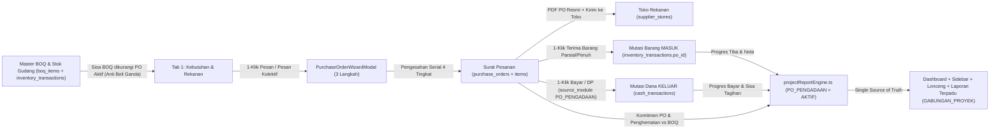

# PANDUAN RESMI: ENGINE DINAMIS PENGADAAN MATERIAL & PO TOKO (`PO_PENGADAAN`) PROYEK CAIR

> **STATUS DOKUMEN: DRAF KEPUTUSAN ARSITEKTUR & RENCANA IMPLEMENTASI TERPADU (TAHAP 2 — MODUL 5)**  
> **Rujukan Baku:** [AGENTS.md](file:///c:/Users/A%20C%20E%20R/antigravity/Proyek%20Cair/AGENTS.md) · [PANDUAN_ENGINE_DINAMIS_MULTI_POV_DAN_MATRIKS_KEPUTUSAN.md](file:///c:/Users/A%20C%20E%20R/antigravity/Proyek%20Cair/docs/PANDUAN_ENGINE_DINAMIS_MULTI_POV_DAN_MATRIKS_KEPUTUSAN.md) · [PANDUAN_ENGINE_DINAMIS_MUTASI_DANA_DAN_REKONSILIASI.md](file:///c:/Users/A%20C%20E%20R/antigravity/Proyek%20Cair/docs/PANDUAN_ENGINE_DINAMIS_MUTASI_DANA_DAN_REKONSILIASI.md) · [TATA_KELOLA_KOREKSI_GANTI_DAN_VERIFIKASI_NOTA.md](file:///c:/Users/A%20C%20E%20R/antigravity/Proyek%20Cair/docs/TATA_KELOLA_KOREKSI_GANTI_DAN_VERIFIKASI_NOTA.md)

Dokumen ini menetapkan rancangan **basis data, *pure engine*, 3 *State Machine*, alur *3-Way Matching* (`PO ↔ Gudang ↔ Kas`), antarmuka 4 Tab, PDF Surat Pesanan resmi, serta 16 titik integrasi efek domino** untuk mengaktifkan modul **Pengadaan Material & PO Toko (`PO_PENGADAAN`)** dengan kualitas setara penuh (*all-aspect parity*) terhadap modul Mutasi Barang dan Mutasi Dana.

---

## 1. LANDASAN PRINSIP & KEPATUHAN TERHADAP 4 KAIDAH `AGENTS.md`

1. **100% Bahasa Indonesia Baku & Ringkas, *Light/Dark* WCAG AA, Notifikasi & Badge:**
   * Seluruh antarmuka memakai istilah alami proyek Indonesia: **`Surat Pesanan (PO)`**, **`Toko Rekanan`**, **`Sisa Perlu Dipesan`**, **`Terima Barang`**, **`Atur Ulang Filter`**, tanpa istilah Inggris (`Draft`, `Approve`, `Vendor`, `Delivery Order`, `Outstanding`, `Grand Total`).
   * Mendukung tema **Terang (*Light*) & Gelap (*Dark*)**, badge Sidebar adaptif warna (*tone-aware*), serta penghitung antrean persetujuan PO di **Lonceng Header**.
2. **Kerumitan *3-Way Matching* Ditangani Sistem di Latar Belakang:**
   * Pengurangan anti-beli-ganda (`Sisa BOQ − Qty Sedang Dipesan PO Aktif`), perbandingan harga grosir PO vs pagu BOQ, pelacakan penerimaan parsial bertahap, penguncian harga satuan PO ke mutasi gudang, hingga tautan pembayaran `source_module = 'PO_PENGADAAN'` dihitung otomatis oleh *pure engine* (`src/lib/procurementEngine.ts`).
   * Pengguna lapangan cukup mengikuti 1 tombol pintar paling relevan per baris.
3. **Integrasi Menyeluruh & Efek Domino Lintas Ekosistem:**
   * Terhubung langsung dua arah ke **Master BOQ**, **Mutasi Barang (`inventory_transactions.po_id`)**, **Album Nota (`project_receipts`)**, **Mutasi Dana (`cash_transactions.source_module = 'PO_PENGADAAN'`)**, **Direktori Toko (`supplier_stores`)**, **Dasbor**, **Sidebar**, **Lonceng Header**, **Beranda Modul (`LandingPageView`)**, **Studio Laporan (`GABUNGAN_PROYEK`)**, dan **Portal Verifikasi QR**.
4. **Saran Cerdas Dinamis (*Smart-Suggestion* & Bebas Tombol Mati):**
   * Item BOQ kurang → **`[ + Pesan ]`**; setelah masuk PO aktif → berubah jadi **`[ 🚚 Pantau ]`** (anti pesan ganda).
   * Siklus baris PO berubah dinamis: `Menunggu Sah` → **`[ ✓ Periksa / Setuju / Sahkan ]`** (sesuai giliran jabatan) → **`[ 📤 Kirim PO ]`** → **`[ ↓ Terima ]`** (saat barang belum tiba 100%) → **`[ ↑ Bayar ]`** (atau **`[ ↓ Isi Kas ]`** saat brankas kas Rp 0) → **`[ 🕒 Riwayat ]`** saat 100% tuntas.

---

## 2. ARSITEKTUR INTEGRASI *3-WAY MATCHING* (`PO ↔ GUDANG ↔ KAS`)



---

## 3. PETA MULTI-POV, PRIVASI RLS & MATRIKS 7 PERAN

### A. Privasi Multi-POV (UI + RLS Sisi Server Sejak Hari Pertama)
* **POV `KONTRAKTOR` (`Clerk` s.d. `CEO/Direktur`):** Akses operasional penuh sesuai jabatan terhadap harga grosir toko, syarat tempo, penerbitan PO, penerimaan barang, dan pembayaran PO.
* **POV `KLIEN` (`Viewer/Pengamat`):** **Terkunci penuh** di UI maupun di PostgreSQL RLS (`private.check_user_project_financial_access(project_id)`). PO toko memuat rahasia harga beli grosir dan termin pembayaran internal kontraktor sehingga menu `Pengadaan & PO` disembunyikan dari Sidebar, rute `procurement` dialihkan aman di `App.tsx`, dan tabel `purchase_orders` / `purchase_order_items` mengembalikan `0` baris serta `42501` bila diakses langsung lewat PostgREST oleh JWT Pengamat.

### B. Matriks 7 Peran Operasional (`ImpersonateRole`)

| Peran Aktif | Otoritas | *Smart-Header* Pengadaan & PO | *1 Smart-Button* Baris PO (Tab 2) | Wewenang Utama |
| :--- | :---: | :--- | :--- | :--- |
| **`Clerk`** | `EKSEKUTOR` | **`[ + Buat Surat Pesanan (PO) ]`** + pintas **`[ 🛒 X Material Perlu Dipesan → ]`** / **`[ 🚚 Y PO Menunggu Tiba → ]`** | Menunggu sah: **`[ ✎ Koreksi ]`**<br>Sah belum kirim: **`[ 📤 Kirim PO ]`**<br>Belum tiba 100%: **`[ ↓ Terima ]`**<br>Tiba/DP belum lunas: **`[ ↑ Bayar ]`** *(atau **`[ ↓ Isi Kas ]`** saat kas Rp 0)*<br>Tuntas/Batal: **`[ 🕒 Riwayat ]`** / **`[ 🕒 Rincian ]`**<br>Diganti: **`[ ↗ Pengganti ]`** | Terbitkan PO (CRU tanpa Hapus), kirim PDF PO ke toko, catat penerimaan barang parsial/penuh ke gudang, bayar DP/pelunasan PO ke kas, inisiasi `BATAL`/`GANTI`. |
| **`Foreman`** | `PENGAWAS_INTERNAL` | Ada antrean: **`[ 🔔 X PO Menunggu Periksa → ]`** *(Biru Langit)*<br>Antrean 0: **`[ ✓ Semua PO Terverifikasi ]`** | Giliran periksa: **`[ ✓ Periksa ]`** *(Biru Langit)* + `[ 🕒 ]`<br>Lainnya: **`[ 🕒 Riwayat ]`** *(+ tombol `Instruksikan Batal / Ganti` di dalam modal)* | **Diperiksa Oleh** (Tahap 1 serial), pantau jadwal kirim lapangan di Tab 3, instruksi `BATAL`/`GANTI`. |
| **`Spv.`** | `PENGAWAS_INTERNAL` | Ada antrean: **`[ 🔔 X PO Menunggu Setuju → ]`** *(Amber)*<br>Antrean 0: **`[ ✓ Semua PO Terverifikasi ]`** | Giliran setuju: **`[ ✓ Setuju ]`** *(Amber)* + `[ 🕒 ]`<br>Lainnya: **`[ 🕒 Riwayat ]`** | **Disetujui Oleh** (Tahap 2 serial), kontrol selisih harga PO vs pagu BOQ, instruksi `BATAL`/`GANTI`. |
| **`Dept. Manager` / `KTT/Proj. Manager` / `CEO/Direktur`** | `PENGAWAS_INTERNAL` | Ada antrean: **`[ 🔔 X PO Menunggu Sahkan → ]`** *(Teal)*<br>Antrean 0: **`[ ✓ Semua PO Terverifikasi ]`** | Giliran sahkan: **`[ ✓ Sahkan ]`** *(Teal)* + `[ 🕒 ]`<br>Lainnya: **`[ 🕒 Riwayat ]`** | **Mengetahui + Sah TTE/QR** (Tahap 3/puncak serial), instruksi `BATAL`/`GANTI`. |
| **`Viewer/Pengamat`** | `PENGAMAT_KLIEN` | *Menu disembunyikan, rute dialihkan, dan diblokir RLS sisi server.* | *Tidak mengakses modul pengadaan internal.* | Memantau progres fisik material tiba melalui Mutasi Barang & Laporan Edisi Klien. |

---

## 4. ARSITEKTUR 4 TAB TERPADU (`ProcurementView.tsx`)

### Tab 1 — `🛒 Kebutuhan & Rekanan` *(Anti Beli Ganda & Direktori Toko)*
1. **4 Kartu KPI Cerdas (*Smart-KPI Grid*):**
   * **Kartu 1 — Perlu Dipesan:** Jumlah material fisik Kontraktor yang masih memiliki `sisaPerluDipesan > 0` beserta estimasi pagu BOQ-nya.
   * **Kartu 2 — Menunggu Pengesahan:** Jumlah PO aktif yang masih di tahap `DITERBITKAN` / `DIPERIKSA` / `DISETUJUI`.
   * **Kartu 3 — Sedang Dikirim / Menunggu Tiba:** Jumlah PO sah yang masih memiliki sisa barang belum tiba di gudang (+ sorotan jika ada yang melewati `estimasi_tiba`).
   * **Kartu 4 — Komitmen & Sisa Tagihan PO:** Total nilai seluruh PO aktif, total sudah dibayar via kas (`source_module = 'PO_PENGADAAN'`), dan sisa kewajiban bayar ke toko (+ selisih hemat/lebih terhadap pagu BOQ).
2. **Tabel A — Saran Pengadaan Otomatis dari BOQ (Anti Beli Ganda):**
   * Sumber: material fisik milik Kontraktor (`is_stock_item === true`, otomatis mengecualikan `Jatah Klien`/`IMK` dan pos jasa).
   * Rumus pasti:
     $$\text{sisaPerluDipesan} = \max\bigl(0,\; \text{qty\_boq} - \text{qty\_masuk\_total} - \text{qty\_sedang\_dipesan\_po}\bigr)$$
     di mana $\text{qty\_sedang\_dipesan\_po}$ adalah total sisa belum tiba pada seluruh PO aktif (tidak `BATAL`/`DIGANTI`) untuk `boq_item_id` terkait.
   * Mendukung **centang multi-item** → muncul bilah aksi **`Buat 1 PO Kolektif (X Material)`** agar Clerk bisa memesan 5–10 item sekaligus ke satu toko tanpa mengetik ulang!
   * Kolom: `[Checkbox]` | `Material & Divisi BOQ` | `Pagu BOQ` | `Tiba di Gudang` | `Di PO Aktif` | **`Perlu Dipesan`** | `Status` | `Aksi` (**`[ + Pesan ]`** atau **`[ 🚚 Pantau ]`**).
3. **Tabel B — Direktori Toko Rekanan (`supplier_stores`):**
   * Menampilkan daftar toko rekanan proyek (kontak, PIC toko, syarat bayar bawaan, jumlah PO aktif, total nilai belanja PO) + tombol tambah/ubah toko dan tombol 1-klik **`[ + Buat PO ]`** dengan toko terisi otomatis.

### Tab 2 — `📋 Daftar Surat Pesanan (PO)` *(Kontrol 3-Way Matching)*
1. **Bar Filter Cepat:** Pil status (`Semua`, `Menunggu Sah`, `Siap Kirim`, `Menunggu Barang`, `Siap Bayar`, `Tuntas`, `Batal / Diganti`), pencarian *non-blocking* (`useDeferredValue` ke no. PO, toko, nama material), filter toko, dan **`Atur Ulang Filter`**.
2. **8 Kolom Bersih & Ergonomis:**
   `No. PO & Tanggal` *(bisa diurutkan)* | `Toko Rekanan & Syarat Bayar` | `Rincian Item & Selisih vs BOQ` | `Total Nilai PO (Rp)` *(bisa diurutkan)* | `Progres Barang (Tiba / Pesan)` | `Progres Bayar (Dibayar / PO)` | `Status & Alur` *(pil badge + lompat `Lihat Pengganti ↗`)* | **`Aksi`** *(1 Smart-Button Fixed-Slot + `[ 🕒 ]`)*.

### Tab 3 — `🚚 Penerimaan Barang (Surat Jalan / DO)`
* Daftar terfokus seluruh PO yang sudah sah/terkirim dan masih memiliki `qtySisaTerima > 0`, dilengkapi indikator jadwal (`Sesuai Jadwal` / `Hari Ini` / **`Terlambat X Hari`**), rincian item tersisa, dan tombol 1-klik **`[ ↓ Terima ]`** yang membuka **Modal Terima Barang PO**:
  * Menampilkan setiap item PO dengan sisa belum tiba (`qty_pesan - qty_diterima`).
  * Clerk dapat menerima **penuh (1-klik "Terima Semua")** maupun **parsial bertahap** (misal pesan 100 sak semen, tiba tahap 1 sebanyak 60 sak).
  * Input tanggal tiba lokal, No. Surat Jalan / Nota Toko, Penanggung Jawab (PIC) penerima gudang, dan unggah foto Surat Jalan/Nota ke `project_receipts` (`receipt_scope = 'BELANJA_BARANG'`).
  * **Efek Otomatis di Latar Belakang (`receivePurchaseOrderItems`):** Menerbitkan baris `MASUK` pada `inventory_transactions` untuk setiap item tiba dengan **`po_id`, `po_item_id`, `harga_satuan_beli = harga_satuan_po` (harga terkunci!), `nama_toko = po.nama_toko`, `receipt_id`**, sehingga stok fisik gudang, pemenuhan BOQ, dan antrean pembayaran otomatis sinkron 100%!

### Tab 4 — `📄 Dokumen PO & Arsip PDF`
* Dilengkapi **`Ganti Jabatan Cepat`** (hanya tampil jika `userAssignments.length > 1`), rekap seluruh Surat Pesanan yang sudah sah TTE/QR, tombol **`PDF PO Toko`** (dokumen siap kirim ke toko dengan kop perusahaan, QR Code, dan blok tanda tangan aktual), serta aksi verifikasi langsung di `VerificationPortal`.

---

## 5. KLASIFIKASI, 3 *STATE MACHINE* & STANDARISASI KOSAKATA BAKU

### A. Syarat Pembayaran PO (`PoPaymentTerms`)
* `'TUNAI_SAAT_TIBA'` (*Tunai / COD Saat Barang Tiba*)
* `'DP_PELUNASAN'` (*Uang Muka (DP) + Pelunasan*)
* `'TEMPO_7'` (*Tempo 7 Hari*)
* `'TEMPO_14'` (*Tempo 14 Hari*)
* `'TEMPO_30'` (*Tempo 30 Hari*)

### B. *State Machine* A — Kesehatan Pengadaan Proyek (`P-1` s.d. `P-4`, Bebas Alarm Palsu)
| Kode | Syarat Matematis | Label | Alarm Kritis (`isPoCritical`) |
| :---: | :--- | :--- | :---: |
| **`P-1`** | `activePoCount === 0` | **`Belum Ada PO`** | `false` *(Dilarang alarm merah!)* |
| **`P-2`** | `activePoCount > 0 && overdueDeliveryCount === 0 && overduePaymentCount === 0` | **`Lancar`** | `false` |
| **`P-3`** | `overdueDeliveryCount > 0 && overduePaymentCount === 0` | **`Kirim Terlambat`** | `false` *(Amber informatif)* |
| **`P-4`** | `overduePaymentCount > 0` *(tagihan PO tempo lewat jatuh tempo)* | **`Jatuh Tempo`** | **`true`** *(Rose di Sidebar/Dasbor)* |

### C. *State Machine* B — Siklus Hidup Baris PO & *1 Smart-Button Fixed-Slot* (`PO-1` s.d. `PO-7`)
| Kode | Kondisi PO | Pil Status (`rounded-full`) | *Smart-Button* `Clerk` | *Smart-Button* `PENGAWAS_INTERNAL` |
| :---: | :--- | :--- | :--- | :--- |
| **`PO-7`** | `is_batal || status_dokumen === 'BATAL'` | **`Batal`** *(Rose)* | **`[ 🕒 Rincian ]`** | **`[ 🕒 Rincian ]`** |
| **`PO-6`** | `is_ganti || status_dokumen === 'DIGANTI'` | **`Diganti`** *(Amber)* | **`[ ↗ Pengganti ]`** | **`[ ↗ Pengganti ]`** |
| **`PO-1`** | Aktif & `status_dokumen !== 'MENGETAHUI'` | `Terbit` / `Diperiksa` / `Disetujui` | **`[ ✎ Koreksi ]`** *(Slate)* + `[ 🕒 ]` | Gilirannya: **`[ ✓ Periksa ]`** (`sky`) / **`[ ✓ Setuju ]`** (`amber`) / **`[ ✓ Sahkan ]`** (`teal`) + `[ 🕒 ]`; Lainnya: **`[ 🕒 Riwayat ]`** |
| **`PO-2`** | `status_dokumen === 'MENGETAHUI' && !sent_to_store_at && qtyDiterima === 0` | **`Siap Kirim`** *(Biru)* | **`[ 📤 Kirim PO ]`** *(Biru)* + `[ 🕒 ]` | **`[ 🕒 Riwayat ]`** |
| **`PO-3`** | Sah & sudah dikirim *(atau terima parsial)* & `qtySisaTerima > 0` | **`Menunggu Tiba`** / **`Tiba Sebagian`** *(Indigo/Amber)* | **`[ ↓ Terima ]`** *(Hijau Zamrud)* + `[ 🕒 ]` | **`[ 🕒 Riwayat ]`** |
| **`PO-4`** | Barang diterima penuh *(atau ada DP belum dibayar)* & `sisaBayarRp > 0` | **`Siap Bayar`** *(Amber/Rose)* | Saldo > 0: **`[ ↑ Bayar ]`** *(Rose)* + `[ 🕒 ]`<br>Saldo ≤ 0: **`[ ↓ Isi Kas ]`** *(Hijau)* + `[ 🕒 ]` | **`[ 🕒 Riwayat ]`** |
| **`PO-5`** | 100% barang diterima & 100% dibayar | **`Tuntas`** *(Teal)* | **`[ 🕒 Riwayat ]`** *(Netral)* | **`[ 🕒 Riwayat ]`** |

### D. Aturan Koreksi `BATAL`/`GANTI` PO (Anti Inkonsistensi 3-Way)
* **Pembatalan (`BATAL`) PO:** Hanya diizinkan jika **`qtyDiterima === 0` dan `totalDibayarRp === 0`** (jika sudah ada penerimaan barang atau pembayaran kas aktif, sistem memberi pesan ramah yang jelas agar membatalkan mutasi barang/kas terkait terlebih dahulu demi menjaga keseimbangan stok dan saldo kas).
* **Penggantian (`GANTI`) PO:** Membuat PO revisi baru bernomor `PO-...-REV`, menautkan `referensi_ganti_id`, dan menandai PO lama `DIGANTI` (hanya sebelum barang diterima; jika sudah ada penerimaan parsial, sisa kuantitas diselesaikan atau dibuat PO susulan baru agar riwayat gudang tetap utuh).

---

## 6. DESAIN WIZARD PO 3 LANGKAH (`PurchaseOrderWizardModal.tsx`)

1. **Langkah 1 — `STORE_TERMS` (*Toko Rekanan & Jadwal Kirim*):**
   * Pilih toko rekanan dari daftar `supplier_stores` (atau tambah toko baru langsung di tempat), pilih syarat pembayaran (`Tunai Saat Tiba`, `DP + Pelunasan`, `Tempo 7/14/30 Hari`), isi nominal DP (bila `DP_PELUNASAN`), tanggal PO, dan estimasi tanggal tiba.
2. **Langkah 2 — `ITEMS_PRICE` (*Daftar Material & Harga Terkunci*):**
   * Jika dibuka dari Tab 1 (`[ + Pesan ]` atau `Buat 1 PO Kolektif`), daftar material + `qty_pesan = sisaPerluDipesan` + `harga_pagu_boq` sudah terisi otomatis.
   * Clerk mengisi/menyesuaikan **Harga Satuan PO (Grosir Toko)**; sistem langsung menampilkan indikator perbandingan **Hemat / Sesuai / Lebih dari Pagu BOQ** per baris maupun total. Dapat menambah baris material BOQ lain atau material khusus.
3. **Langkah 3 — `REVIEW` & `DONE_NEXT` (*Konfirmasi & Cetak PO*):**
   * Ringkasan 1 layar (Toko, Syarat Bayar, Total PO, Selisih vs BOQ, Catatan Kirim ke Toko) → **`Terbitkan Surat Pesanan (PO)`** → layar selesai `DONE_NEXT` berisi tombol **`Cetak PDF PO`**, **`Buat PO Lagi`**, dan **`Selesai & Tutup`**.

---

## 7. RANCANGAN MIGRASI DATABASE SUPABASE (`supabase/migrations/20261124020000_procurement_po_schema.sql`)

Mengikuti `supabase-postgres-best-practices` (idempoten, FK terindeks parsial, RLS sisi server ketat dengan `private.check_user_project_financial_access` sejak hari pertama):

```sql
-- 1. Perluasan direktori toko rekanan (supplier_stores)
ALTER TABLE public.supplier_stores
  ADD COLUMN IF NOT EXISTS pic_toko text,
  ADD COLUMN IF NOT EXISTS syarat_bayar_default text NOT NULL DEFAULT 'TUNAI_SAAT_TIBA',
  ADD COLUMN IF NOT EXISTS catatan text,
  ADD COLUMN IF NOT EXISTS is_active boolean NOT NULL DEFAULT true;

-- 2. Tabel header Surat Pesanan (purchase_orders)
CREATE TABLE IF NOT EXISTS public.purchase_orders (
  id uuid PRIMARY KEY DEFAULT gen_random_uuid(),
  workspace_id uuid REFERENCES public.workspaces(id) ON DELETE CASCADE,
  project_id uuid NOT NULL REFERENCES public.projects(id) ON DELETE CASCADE,
  po_no text NOT NULL UNIQUE,
  store_id uuid REFERENCES public.supplier_stores(id) ON DELETE SET NULL,
  nama_toko text NOT NULL,
  toko_kontak text,
  tanggal_po timestamptz NOT NULL DEFAULT now(),
  estimasi_tiba date,
  payment_terms text NOT NULL DEFAULT 'TUNAI_SAAT_TIBA',
  jatuh_tempo_bayar date,
  dp_amount_rp numeric(18,2) NOT NULL DEFAULT 0 CHECK (dp_amount_rp >= 0),
  total_amount_rp numeric(18,2) NOT NULL DEFAULT 0 CHECK (total_amount_rp >= 0),
  catatan_toko text,
  sent_to_store_at timestamptz,
  created_by uuid REFERENCES auth.users(id),
  created_by_name text,
  status_dokumen text NOT NULL DEFAULT 'DITERBITKAN',
  diperiksa_oleh text,
  disetujui_oleh text,
  mengetahui_oleh text,
  tte_qr_code text,
  is_batal boolean NOT NULL DEFAULT false,
  is_ganti boolean NOT NULL DEFAULT false,
  referensi_ganti_id uuid REFERENCES public.purchase_orders(id) ON DELETE SET NULL,
  alasan_batal_ganti text,
  created_at timestamptz NOT NULL DEFAULT now(),
  updated_at timestamptz NOT NULL DEFAULT now(),
  CONSTRAINT purchase_orders_payment_terms_check
    CHECK (payment_terms IN ('TUNAI_SAAT_TIBA', 'DP_PELUNASAN', 'TEMPO_7', 'TEMPO_14', 'TEMPO_30')),
  CONSTRAINT purchase_orders_status_dokumen_check
    CHECK (status_dokumen IN ('DITERBITKAN', 'DIPERIKSA', 'DISETUJUI', 'MENGETAHUI', 'BATAL', 'DIGANTI'))
);

-- 3. Tabel baris item Surat Pesanan (purchase_order_items)
CREATE TABLE IF NOT EXISTS public.purchase_order_items (
  id uuid PRIMARY KEY DEFAULT gen_random_uuid(),
  po_id uuid NOT NULL REFERENCES public.purchase_orders(id) ON DELETE CASCADE,
  project_id uuid NOT NULL REFERENCES public.projects(id) ON DELETE CASCADE,
  boq_item_id uuid REFERENCES public.boq_items(id) ON DELETE SET NULL,
  nama_barang text NOT NULL,
  satuan text NOT NULL DEFAULT 'Unit',
  qty_pesan numeric(18,4) NOT NULL CHECK (qty_pesan > 0),
  harga_satuan_po numeric(18,2) NOT NULL DEFAULT 0 CHECK (harga_satuan_po >= 0),
  harga_pagu_boq numeric(18,2) NOT NULL DEFAULT 0 CHECK (harga_pagu_boq >= 0),
  subtotal_rp numeric(18,2) NOT NULL DEFAULT 0 CHECK (subtotal_rp >= 0),
  catatan text,
  sort_order integer NOT NULL DEFAULT 0,
  created_at timestamptz NOT NULL DEFAULT now()
);

-- 4. Tautan 2 arah pada inventory_transactions
ALTER TABLE public.inventory_transactions
  ADD COLUMN IF NOT EXISTS po_id uuid REFERENCES public.purchase_orders(id) ON DELETE SET NULL,
  ADD COLUMN IF NOT EXISTS po_item_id uuid REFERENCES public.purchase_order_items(id) ON DELETE SET NULL;

-- 5. Indeks performa & RLS sisi server ketat (hanya akses finansial kontraktor / non-Viewer)
CREATE INDEX IF NOT EXISTS idx_purchase_orders_project_date
  ON public.purchase_orders (project_id, tanggal_po DESC);
CREATE INDEX IF NOT EXISTS idx_purchase_order_items_po_id
  ON public.purchase_order_items (po_id);
CREATE INDEX IF NOT EXISTS idx_purchase_order_items_boq_item_id
  ON public.purchase_order_items (boq_item_id) WHERE boq_item_id IS NOT NULL;
CREATE INDEX IF NOT EXISTS idx_inventory_transactions_po_id
  ON public.inventory_transactions (po_id) WHERE po_id IS NOT NULL;
CREATE INDEX IF NOT EXISTS idx_inventory_transactions_po_item_id
  ON public.inventory_transactions (po_item_id) WHERE po_item_id IS NOT NULL;

GRANT SELECT, INSERT, UPDATE, DELETE ON public.purchase_orders TO authenticated, service_role;
GRANT SELECT, INSERT, UPDATE, DELETE ON public.purchase_order_items TO authenticated, service_role;

ALTER TABLE public.purchase_orders ENABLE ROW LEVEL SECURITY;
ALTER TABLE public.purchase_order_items ENABLE ROW LEVEL SECURITY;

DROP POLICY IF EXISTS "purchase_orders_financial_access" ON public.purchase_orders;
CREATE POLICY "purchase_orders_financial_access" ON public.purchase_orders
  FOR ALL TO authenticated
  USING ((SELECT private.check_user_project_financial_access(project_id)))
  WITH CHECK ((SELECT private.check_user_project_financial_access(project_id)));

DROP POLICY IF EXISTS "purchase_order_items_financial_access" ON public.purchase_order_items;
CREATE POLICY "purchase_order_items_financial_access" ON public.purchase_order_items
  FOR ALL TO authenticated
  USING ((SELECT private.check_user_project_financial_access(project_id)))
  WITH CHECK ((SELECT private.check_user_project_financial_access(project_id)));

NOTIFY pgrst, 'reload schema';
```

---

## 8. PETA 16 TITIK INTEGRASI EFEK DOMINO (5 LAPISAN)

### Lapisan 1 — Basis Data Supabase
1. **`[NEW]` `supabase/migrations/20261124020000_procurement_po_schema.sql`:** Skema `purchase_orders`, `purchase_order_items`, perluasan `supplier_stores`, tautan `inventory_transactions.po_id`/`po_item_id`, indeks, dan RLS sisi server ketat non-Viewer.

### Lapisan 2 — Tipe Data, *Pure Engine* & Pengujian Otomatis
2. **`[MODIFY]` [src/types/index.ts](file:///c:/Users/A%20C%20E%20R/antigravity/Proyek%20Cair/src/types/index.ts):** Tambah tipe `PurchaseOrder`, `PurchaseOrderItem`, `PoPaymentTerms`, perluas `SupplierStore`, `MutasiBarang` (`po_id`, `po_item_id`), dan `DokumenLaporan.jenis` (`'PO_PENGADAAN'`).
3. **`[NEW]` `src/lib/procurementEngine.ts`:** *Engine* murni: `isPoRowExcluded()`, `computeProcurementNeeds()` (anti beli ganda BOQ vs PO aktif), `evaluatePurchaseOrder()` (*State Machine* `PO-1..PO-7` + progres 3-way terima/bayar + Smart-Button 7 peran), `computeProcurementSummaryMetrics()` (`P-1..P-4` bebas alarm palsu), `buildPoModuleContribution()` untuk `projectReportEngine`, dan helper Wizard/Terima Barang.
4. **`[NEW]` `src/lib/procurementEngine.test.ts`:** Unit test $\ge 15$ skenario (anti beli ganda, pengecualian Jatah Klien/IMK & pos jasa, progres penerimaan parsial & penuh, kalkulasi sisa bayar & penghematan vs BOQ, penguncian `BATAL` saat sudah ada terima/bayar, *State Machine* 7 peran + tombol `ISI_KAS` saat saldo kas Rp 0, anti alarm palsu `P-1`).

### Lapisan 3 — Konteks Aplikasi & Penyimpanan
5. **`[MODIFY]` [src/context/AppContext.tsx](file:///c:/Users/A%20C%20E%20R/antigravity/Proyek%20Cair/src/context/AppContext.tsx):** Muat `purchase_orders`, `purchase_order_items`, dan `supplier_stores`; tambah aksi `createPurchaseOrder`, `advancePurchaseOrderWorkflow` (validasi serial 4 tingkat), `markPurchaseOrderSent`, `receivePurchaseOrderItems` (otomatis insert `inventory_transactions` `MASUK` ber-`po_id`/`po_item_id` + `project_receipts`), `payPurchaseOrder` (otomatis insert `cash_transactions` `KELUAR` ber-`source_module = 'PO_PENGADAAN'` & `source_entity_id/no`), `batalPurchaseOrder`, `gantiPurchaseOrder`, serta ekspor `procurementSummary`, `pendingPoApprovalCount` (masuk `pendingApprovalCount`), dan `procurementTargetTab`.
6. **`[MODIFY]` [src/lib/cashflowEngine.ts](file:///c:/Users/A%20C%20E%20R/antigravity/Proyek%20Cair/src/lib/cashflowEngine.ts):** Cegah penagihan ganda di Tab 2 Rekonsiliasi Kas: nota gudang dari mutasi stok ber-`po_id` yang PO-nya sudah lunas dibayar melalui `source_module = 'PO_PENGADAAN'` otomatis dianggap lunas (tidak muncul ganda sebagai utang nota!).

### Lapisan 4 — Antarmuka Utama Modul Pengadaan & PO Toko
7. **`[NEW]` `src/components/PurchaseOrderWizardModal.tsx`:** Modal Wizard 3 langkah + perbandingan harga grosir vs pagu BOQ + *pre-fill* 1-klik / pesan kolektif dari Tab 1 + tambah toko rekanan cepat.
8. **`[NEW]` `src/components/ProcurementView.tsx`:** 4 Tab Terpadu (`Kebutuhan & Rekanan`, `Daftar Surat Pesanan (PO)`, `Penerimaan Barang (DO)`, `Dokumen PO & PDF`), Smart-Header adaptif, 1 Smart-Button Fixed-Slot WCAG AA, modal **Terima Barang PO** (parsial/penuh), modal **Bayar PO 1-Klik**, modal **Riwayat + Instruksi Batal/Ganti Pengawas**, dan `Ganti Jabatan Cepat` khusus multi-penugasan.

### Lapisan 5 — Integrasi Efek Domino Lintas Aplikasi
9. **`[MODIFY]` [src/lib/projectReportEngine.ts](file:///c:/Users/A%20C%20E%20R/antigravity/Proyek%20Cair/src/lib/projectReportEngine.ts):** Aktifkan `PO_PENGADAAN` (`status: 'AKTIF'`) dan masukkan kontribusi PO (`totalPoCommitmentRp`, `totalPoPaidRp`, `pendingCount`) ke `IntegratedProjectReportData`.
10. **`[MODIFY]` [src/lib/pdfGenerator.ts](file:///c:/Users/A%20C%20E%20R/antigravity/Proyek%20Cair/src/lib/pdfGenerator.ts):** Tambah **`generatePurchaseOrderPDF()`** (Surat Pesanan resmi siap kirim ke toko rekanan dengan kop perusahaan, QR Code, rincian harga terkunci, syarat bayar, & tanda tangan 4 tingkat aktual) serta perbarui Bab 2 `generateIntegratedProjectReportPDF()` dengan status aktif `PO_PENGADAAN`.
11. **`[MODIFY]` [src/App.tsx](file:///c:/Users/A%20C%20E%20R/antigravity/Proyek%20Cair/src/App.tsx):** Tambah rute lazy `currentView === 'procurement'` dengan penjagaan ketat `activeRole !== 'Viewer/Pengamat'` (dialihkan aman untuk Pengamat).
12. **`[MODIFY]` [src/components/Sidebar.tsx](file:///c:/Users/A%20C%20E%20R/antigravity/Proyek%20Cair/src/components/Sidebar.tsx):** Tambah menu **`Pengadaan & PO`** (`ShoppingBag`, khusus non-Viewer) lengkap dengan badge adaptif warna (*tone-aware*).
13. **`[MODIFY]` [src/components/Header.tsx](file:///c:/Users/A%20C%20E%20R/antigravity/Proyek%20Cair/src/components/Header.tsx):** Masukkan antrean persetujuan PO (`pendingPoApprovalCount`) ke badge lonceng dan daftar dropdown dengan navigasi langsung ke `procurement`.
14. **`[MODIFY]` [src/components/DashboardView.tsx](file:///c:/Users/A%20C%20E%20R/antigravity/Proyek%20Cair/src/components/DashboardView.tsx):** Tambah pintasan `+ Buat Surat Pesanan (PO)` di popover aksi cepat (khusus Clerk) serta indikator komitmen PO aktif.
15. **`[MODIFY]` [src/components/StockMutationView.tsx](file:///c:/Users/A%20C%20E%20R/antigravity/Proyek%20Cair/src/components/StockMutationView.tsx) & [src/components/CashflowView.tsx](file:///c:/Users/A%20C%20E%20R/antigravity/Proyek%20Cair/src/components/CashflowView.tsx):** Tampilkan lencana tautan **`PO: PO-...`** pada baris mutasi barang masuk & baris kas keluar yang bersumber dari modul PO.
16. **`[MODIFY]` [src/components/LandingPageView.tsx](file:///c:/Users/A%20C%20E%20R/antigravity/Proyek%20Cair/src/components/LandingPageView.tsx), [src/components/ReportsView.tsx](file:///c:/Users/A%20C%20E%20R/antigravity/Proyek%20Cair/src/components/ReportsView.tsx) & [src/components/VerificationPortal.tsx](file:///c:/Users/A%20C%20E%20R/antigravity/Proyek%20Cair/src/components/VerificationPortal.tsx):** Ubah status kartu `Pengadaan Material & PO Toko` di `LandingPageView` menjadi **`ACTIVE` (`Aktif & Siap Pakai`)**, tampilkan kontribusi aktif `PO_PENGADAAN` di `ReportsView`, dan dukung tampilan label `'PO_PENGADAAN'` di `VerificationPortal`.

---

## 9. RENCANA VERIFIKASI & KEPUTUSAN KUNCI SEBELUM EKSEKUSI

### A. Verifikasi Otomatis & Database
1. Terapkan migrasi `20261124020000_procurement_po_schema.sql` ke Supabase (2× idempoten) + uji transaksional RLS 3 peran (`Kontraktor` vs `Viewer/Pengamat` vs `Non-anggota`) + `get_advisors` (`security` & `performance`).
2. Jalankan `npm test` (wajib 100% lulus seluruh 52 tes eksisting + $\ge 15$ skenario `procurementEngine.test.ts`), `npx tsx --test src/context/AppContext.test.ts`, `npm run lint`, dan `npm run build` (`0` galat).

### B. 4 Keputusan Kunci untuk Konfirmasi Anda

> [!IMPORTANT]
> Sebelum eksekusi kode dan migrasi `supabase/**` dimulai, mohon konfirmasi 4 keputusan rancangan inti berikut:
> 1. **Anti Beli Ganda Otomatis dari BOQ:** Tab 1 secara otomatis menghitung `Sisa Perlu Dipesan = max(0, Sisa BOQ − Qty Sedang Dipesan di PO Aktif)` khusus material fisik Kontraktor (mengecualikan `Jatah Klien`/`IMK` dan pos jasa), serta mendukung **Pesan Kolektif multi-material ke 1 Toko**.
> 2. **Alur *3-Way Matching* Terkunci (`PO ↔ Gudang ↔ Kas`):** Tombol 1-klik **`[ ↓ Terima ]`** mendukung penerimaan parsial/penuh yang langsung membuat mutasi `MASUK` gudang dengan harga satuan PO terkunci; tombol 1-klik **`[ ↑ Bayar ]`** langsung membuat transaksi kas `KELUAR` bertaut `source_module = 'PO_PENGADAAN'` dan otomatis mencegah tagihan ganda di Tab 2 Rekonsiliasi Kas.
> 3. **Privasi Ketat Non-Viewer sejak Hari Pertama:** Tabel `purchase_orders` & `purchase_order_items` langsung dilindungi RLS sisi server `private.check_user_project_financial_access(project_id)` sehingga `Viewer/Pengamat` 100% tidak dapat membaca maupun menulis data PO toko kontraktor.
> 4. **Pengesahan Serial 4 Tingkat & PDF Surat Pesanan Siap Kirim:** PO mengikuti rantai `Clerk → Foreman → Spv. → Dept. Mgr / KTT / CEO (TTE/QR)`, dilarang dihapus permanen (hanya `BATAL`/`GANTI` bila belum ada barang diterima/bayar), dan dilengkapi **`generatePurchaseOrderPDF()`** siap kirim ke toko rekanan.

---

*Silakan tinjau panduan ini. Jika ke-4 keputusan kunci di atas sudah sesuai, beri persetujuan agar saya dapat langsung mengeksekusi implementasi Lapisan 1 s.d. Lapisan 5 untuk Modul Pengadaan Material & PO Toko.*
