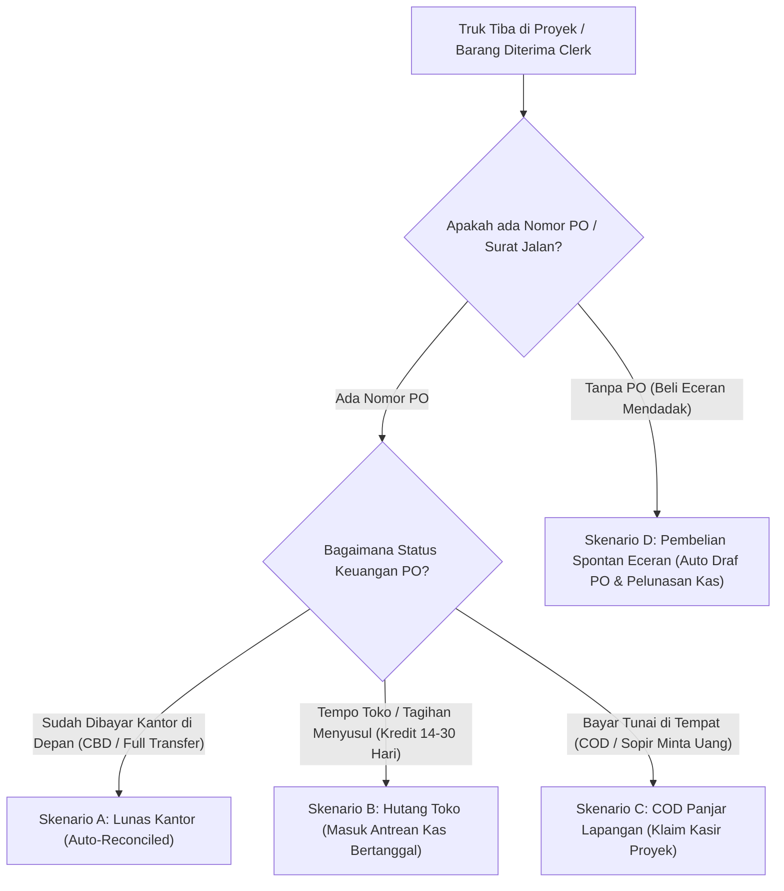

# Rencana Masa Depan (Upcoming-Maybe Plan): Integrasi Cerdas Barang Masuk Gudang & Pembayaran PO

> **Status Dokumen**: *Draft Perencanaan / Upcoming-Maybe Plan*  
> **Target Pengguna**: Tim Lapangan (*Clerk* / Mandor Gudang), Manajer Logistik (*Purchasing*), dan Tim Keuangan / Kasir Proyek.  
> **Prinsip Utama**: *"Petugas lapangan fokus pada fisik barang & surat jalan; biarkan sistem menangani kerumitan akuntansi dan status pembayaran di latar belakang."*

---

## 1. Latar Belakang & Masalah Riil di Lapangan

Pada kenyataan proyek konstruksi di lapangan (khususnya proyek berskala kecil hingga menengah), terjadi pemisahan sudut pandang (*POV*) yang sangat kontras antara fisik dan finansial:
1. **Petugas Gudang / *Clerk* Lapangan**:
   - Hanya berhadapan dengan supir truk, surat jalan (*Delivery Order* / DO), dan tumpukan fisik material yang diturunkan.
   - Tidak tahu-menahu (dan memang tidak perlu dibebani) apakah barang tersebut sudah dibayar lunas oleh kantor pusat, masih DP, hutang tempo 30 hari, atau supir menuntut uang tunai di tempat.
   - Jika dipaksa harus memilih status bayar saat barang tiba, timbul kesalahan fatal (*human error*): nota tercatat lunas padahal belum dibayar kantor, atau sebaliknya nota ditagihkan ulang ke kas proyek (pembayaran ganda).
2. **Tim Keuangan & Kasir**:
   - Membutuhkan kepastian bahwa uang keluar benar-benar memiliki wujud fisik barang yang sah diterima di gudang (prinsip *3-Way Matching*: **PO $\leftrightarrow$ Surat Jalan Gudang $\leftrightarrow$ Kuitansi/Nota Kas**).
   - Membutuhkan pencegahan mutlak atas risiko membayar ganda (*double payment*) atas barang yang sebelumnya sudah ditransfer dari kantor atau sudah dibayar panjar.

---

## 2. Pemetaan 4 Skenario Riil Kedatangan Barang di Proyek

Untuk mengatasi situasi tanpa membebani *clerk*, sistem mengidentifikasi dan menangani **4 skenario operasional**:

### Skenario A: Pembayaran di Depan oleh Kantor (*Cash Before Delivery* / CBD / Transfer Bank Pusat)
- **Kondisi**: Kantor pusat telah mentransfer dana ke toko semen/besi sebelum barang dikirim. Supir hanya membawa Surat Jalan tanpa nota tagihan uang.
- **Tindakan Clerk**: Membuka form penerimaan, memilih nomor PO yang terdaftar, memeriksa jumlah fisik (misal: 200 sak semen), lalu klik **"Terima Barang Sesuai Surat Jalan"**.
- **Otomasi Sistem di Latar Belakang**:
  - Stok gudang bertambah 200 sak secara instan.
  - Sistem mendeteksi bahwa PO tersebut telah memiliki transaksi kas keluar via Bank Kantor.
  - Nota barang langsung ditandai secara otomatis: `✓ Terbayar via Transfer Kantor (PO #PO-2026-001)`.
  - Nota **TIDAK DIMASUKKAN** ke Antrean Tagihan Kas Lapangan (mencegah kasir proyek membayar ulang).

### Skenario B: Tempo Toko / Tagihan Menyusul (Kredit 14–30 Hari)
- **Kondisi**: Toko langganan mengirim barang dengan Surat Jalan; penagihan (*invoice*) akan dikirimkan kolektif setiap akhir bulan.
- **Tindakan Clerk**: Memverifikasi fisik barang dan nomor Surat Jalan.
- **Otomasi Sistem di Latar Belakang**:
  - Stok gudang bertambah.
  - Nilai barang dicatat sebagai **Kewajiban / Hutang Usaha Toko**.
  - Pada Tab Rekonsiliasi Kas, nota muncul dalam kelompok *Status: "Tempo Toko (Jatuh Tempo: DD/MM/YYYY)"* dengan tombol cerdas `Bayar Tagihan Tempo` saat invoice fisik toko tiba.

### Skenario C: Bayar Tunai di Tempat (*Cash on Delivery* / COD)
- **Kondisi**: Supir material menolak menurunkan muatan sebelum uang tunai diserahkan. Mandor/Petugas Gudang menggunakan uang panjar operasional di sakunya.
- **Tindakan Clerk**: Mencatat penerimaan barang dan mengaktifkan saklar satu-sentuhan: `[✓] Dibayar Langsung dari Kas/Panjar Lapangan`.
- **Otomasi Sistem di Latar Belakang**:
  - Sistem langsung mengaitkan pengeluaran ini dengan pemegang panjar terkait (misal: Panjar Mandor Lapangan).
  - Mengurangi sisa panjar mandor dan langsung membuat draf bukti pertanggungjawaban (LPJ Kas).
  - Tagihan langsung berstatus `✓ Lunas di Lapangan`, tidak lagi muncul di antrean tagihan kantor.

### Skenario D: Pembelian Spontan / Eceran Tanpa PO di Lapangan
- **Kondisi**: Paku atau kawat habis mendadak di tengah pengecoran. Pekerja disuruh lari ke toko bangunan terdekat membeli barang secara tunai tanpa sempat membuat PO di sistem.
- **Tindakan Clerk**: Mengambil foto nota sobekan toko lewat HP, memasukkan nama barang dan total rupiah.
- **Otomasi Sistem di Latar Belakang**:
  - Sistem membuatkan draf PO bayangan (*Auto-Generated PO*) berkategori "Pembelian Eceran Langsung".
  - Stok gudang langsung bertambah dan dicatat keluar (*langsung dipakai* jika dialokasikan ke pos pekerjaan).
  - Terkoneksi otomatis ke antrean kasir untuk penggantian uang (*reimbursement*) atau pelunasan panjar.

---

## 3. Mekanisme Proteksi Sistem (*System Intelligence & Guardrails*)

### 3.1. *3-Way Matching Engine*
Sistem melakukan pencocokan otomatis 3 titik data:
$$\text{Purchase Order (PO)} \quad\longleftrightarrow\quad \text{Surat Jalan / Fisik Masuk} \quad\longleftrightarrow\quad \text{Kuitansi / Kas Keluar}$$

| Kondisi | Status Visual | Tindakan Cerdas yang Ditawarkan (*Smart-Action*) |
|---|---|---|
| Barang tiba sama dengan PO & sudah dibayar kantor | `🟢 Lunas & Sesuai` | Tombol arsip dokumen / tidak perlu tindakan kasir. |
| Barang tiba sebagian (parsial), pembayaran penuh | `🟡 Tiba Parsial (Sisa X unit)` | Muncul badge antrean: *"Menunggu sisa pengiriman toko"*. |
| Barang tiba utuh, kas belum keluar (Tempo) | `🔵 Menunggu Pelunasan Toko` | Tombol `[ ↗ Bayar Kas ]` aktif di Tab Rekonsiliasi Kasir. |
| Tagihan toko lebih tinggi dari harga PO | `🔴 Selisih Harga / Klaim` | Tombol `[ Tinjau Selisih ]` mewajibkan otorisasi Manajer Proyek. |

### 3.2. Tombol Aksi Cerdas Dinamis (*Smart-Suggestions*)
Sesuai asas panduan desain:
- Tombol di antrean gudang tidak bersifat statis.
- Jika suatu PO sudah dibayar lunas via transfer bank kantor, tombol `Bayar` berubah menjadi label informatif non-klik: `✓ Lunas via Transfer (PO #...)`.
- Jika suatu PO memiliki sisa tagihan (misal baru dibayar DP 30%), tombol berubah menjadi: `[ ↗ Lunasi Sisa Rp ... ]`.
- Jika barang milik Jatah Klien (*owner_type = 'KLIEN'*), tombol `Bayar` dinonaktifkan dengan penanda jelas: `Aset Klien (Bebas Biaya Kas)`.

### 3.3. Pelacakan Uang Muka / DP (*Down Payment Guard*)
- Sistem mencatat riwayat termin pembayaran per PO (`uang_muka_dibayar`, `sisa_tagihan`).
- Saat barang masuk gudang, sistem tidak langsung menagih 100% nominal nota jika ada riwayat DP yang sudah dibukukan di Kas Keluar.
- Nilai yang ditarik ke antrean kasir murni sebesar:
$$\text{Tagihan Bersih Kas} = \text{Total Nilai Fisik Tiba} - \text{Total DP / Panjar yang Sudah Dicairkan}$$

---

## 4. Rencana Implementasi Bertahap (Bila Diputuskan Dikerjakan)

1. **Fase I**: Penyempurnaan Skema Database
   - Menambahkan relasi `po_id` opsional pada tabel `inventory_transactions`.
   - Menambahkan kolom status finansial barang masuk: `payment_source ('KANTOR_PUSAT', 'KAS_PROYEK', 'TEMPO_TOKO', 'PANJAR_PERSONAL')`.
2. **Fase II**: Penyederhanaan Formulir Kedatangan Barang
   - Penambahan opsi instan di modal penerimaan: *Pilih dari Surat Jalan PO Terbit*.
   - Saat nomor PO dipilih, item dan harga terisi otomatis 100% (petugas gudang hanya menghitung jumlah fisik yang datang).
3. **Fase III**: Penyesuaian Tab Rekonsiliasi & Notifikasi Kas
   - Filter antrean nota gudang memisahkan antara: *Siap Bayar Kas Lapangan* vs *Tagihan Tempo Jatuh Tempo* vs *Lunas Kantor*.
   - Notifikasi bel hanya menghitung nota yang **benar-benar menjadi beban kasir lapangan**.

---
*Dokumen ini disusun sebagai panduan konseptual masa depan agar pengembangan sistem ke depan tetap selaras dengan kenyataan operasional lapangan.*
